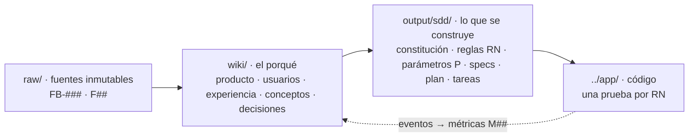

# Gym Bro

> **Entrenas solo. No estás solo.** — lema recomendado, pendiente de validar con usuarios ([[voz-y-marca]]).

Bot de Telegram **estructurado** —botones, comandos y mensajes que llegan antes de pedirlos; sin charla libre ni personaje— que ayuda a hombres de 18 a 32 años que entrenan solos a ser constantes con su entreno y su comida. Cada día que entrena en el gym, en casa o en versión exprés, **cuenta**. **Fase 0:** el fundador lo usa con un protocolo N-de-1 (A-B-A) antes de abrir una alfa pequeña en Colombia.

## Por dónde empezar

| Si eres… | Lee en este orden |
|---|---|
| PO o diseño | [[propuesta-de-valor]] → [[usuario-cabeza-01]] → [[cada-dia-cuenta]] → [[proactividad-sin-spam]] → [[registro-sin-friccion]] |
| Nutricionista o entrenador (validación) | Filas `[VALIDAR-PROFESIONAL]` de [[reglas-de-negocio]] → valores `[V]` de [[parametros]] → [[catalogo-de-ejercicios-base]] → [[alimentos-accesibles-base]] → respuestas de cuidado en [[plantillas-de-mensajes]] |
| Desarrollo con Claude Code | [[leeme-output]] → [[constitucion]] → [[spec-000-vision-fase-0]] → [[tareas-fase-0]] |
| Cualquier consulta | [[index]] y el lienzo [[mapa-de-trazabilidad.canvas]] |

## Cómo está organizada

El esquema y las operaciones (*ingest*, *query*, *derive*, *lint*) están en `vault/CLAUDE.md`; el patrón es el *LLM Wiki* de Karpathy (`F01`), extendido con la capa `output/` para *spec-driven development*.

## Estado de los hitos (2026-10-18)

| Hito | Estado |
|---|---|
| H0 Fundamentación | Propuesta de valor v0.2 lista para aprobación del PO |
| H1 Descubrimiento | Pendiente: entrevistas, concierge y prueba del canal Telegram (en paralelo a H4) |
| H2 Diseño de experiencia | Borrador en `wiki/experiencia/` |
| H3 Especificación | Paquete SDD v0.1 listo para revisión |
| H4 Construcción Fase 0 | Empieza en Claude Code con T-001 |

## Decisiones que enmarcan todo

ADR-002 (Telegram en la Fase 0/01) · ADR-006 (bot estructurado, sin personaje) · ADR-008 (hombres de 18 a 32 años) · ADR-009 (sin núcleo social). Detalle en [[registro-de-decisiones]].

## Preguntas abiertas para el PO

> [!question] Responderlas desbloquea o ajusta trabajo concreto
> - **Q1** ¿Colombia como mercado inicial? · **Q2** tu línea base personal · **Q3** presupuesto y semanas para la Fase 0
> - **Q4** nutricionista y entrenador certificado (necesario antes de la alfa) · **Q5** responsable del tratamiento de datos
> - **Q6** iPhone o Android; ¿Hevy, Strava o reloj? · **Q7** nombre y usuario del bot · **Q8** MongoDB o PostgreSQL · **Q9** Mini App en Fase 0 o 1
>
> Detalle e impacto: [[propuesta-de-valor#19. Preguntas abiertas]].
