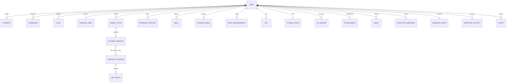

# Modelo de datos · Fase 0

> Para MongoDB (ADR-015; Q8 respondida el 2026-10-19). Nombres de colecciones y campos en inglés según el [[glosario]]. Todas las fechas y horas se guardan en UTC; el **día operativo** (`date`, formato `AAAA-MM-DD`) se calcula en el dominio con la zona del usuario (RN-DQC-001).

## 1. Diagrama

## 2. Colecciones

| Colección | Campos principales | Índices | Reglas / invariantes |
|---|---|---|---|
| `users` | `telegramUserId` (único), `chatId`, `status` (`active`·`paused`·`blocked`·`deleted`), `timezone`, `isAdultConfirmedAt`, `sex` (opcional, declarado), `level`, `equipmentProfile`, `settings` {`intensity`, `quietHours`, `purposesEnabled` (propósito → encendido; uno que falta está encendido, RN-MSJ-001), `gamificationEnabled`, `numberFreeMode`, `lowIntensityStart`}, `profile` {`goalType`, `level`, `availableDays`, `timeSlot`, `place`, `sessionMinutes`, `homeEquipment`, `heightCm`}, `onboarding` {`step`, `startedAt`, `interactions`, `completedAt`} | `telegramUserId` único | No se guarda la fecha de nacimiento: solo la confirmación de mayoría de edad (minimización, RN-SEG-001) |
| `consents` | `userId`, `category` (`health_data`·`body_measurements`·`screening`·`ai_processing`·`analytics`), `granted`, `at`, `policyVersion` | `userId+category` | RN-DAT-001 |
| `screenings` | `userId`, `type` (`pre_activity`·`food_body`), `result` (`clear`·`flag`), `at` | `userId` | **No se guardan las respuestas**, solo el resultado (minimización); solo con autorización `screening`. Las consecuencias (`lowIntensityStart`, `numberFreeMode`) van en `users.settings` siempre ([[tamizajes]] §3) |
| `goals` | `userId`, `type`, `metric`, `startValue`, `targetValue`, `startDate`, `horizonWeeks`, `status` (`active`·`completed`·`partially_completed`·`changed`·`paused`), `closedAt`, `progressPct` | `userId+status` | Un solo `active` por usuario (RN-OBJ-001). `startValue` y `targetValue` quedan en null en un objetivo sin meta de peso del onboarding, hasta tener datos |
| `training_habits` | `userId`, `days[]` {`weekday`, `declaredStart`, `learnedStart`, `location`} | `userId` único | RN-PLAN-002, RN-MSJ-006. `learnedStart` lo actualiza el planificador cuando hay P-049 sesiones de ese día; mientras tanto vale null y se usa la declarada |
| `weekly_plans` | `userId`, `weekStart`, `days[]` {`date`, `dayType`, `plannedSessionId`}, `nextRotationStart`, `intensity` (`low`·`normal`) | `userId+weekStart` único | RN-PLAN-001 a 009. Se guarda una sola vez por semana; la siguiente continúa la rotación desde `nextRotationStart` (RN-PLAN-007) |
| `planned_sessions` | `userId`, `date`, `template` (código de sesión, [[catalogo-de-ejercicios-base]] §5), `versions` {`GYM`, `HOME`, `EXPRESS`: {`exercises[]` {`exerciseCode`, `pattern`, `sets`, `reps` {min, max}, `targetReps`, `loadKg`, `restSeconds`}, `estimatedMinutes`}} | `userId+date` | RN-PLAN-003, RN-PLAN-006 |
| `workout_sessions` | `userId`, `plannedSessionId`, `date`, `template`, `variant`, `status` (`active`·`completed`·`partial`·`abandoned`), `startedAt`, `endedAt`, `loggedAsPlanned`, `progress` (estado de la tarjeta: ejercicios, serie que toca, valores pendientes y series registradas), `rev`, `lastConfirmedAt` | `userId+date`; `userId+startedAt` | RN-ENT-004. La hora habitual aprendida (RN-MSJ-006) sale de las últimas sesiones por `startedAt`. `rev` sube en cada cambio: un toque de una tarjeta vieja no modifica nada (FR-003-03) |
| `set_entries` | `sessionId`, `userId`, `exerciseCode`, `setIndex`, `reps`, `loadKg`, `edited`, `confirmedAt`, `idempotencyKey` | `idempotencyKey` único | RN-ENT-001; NFR-03 |
| `personal_records` | `userId`, `exerciseCode`, `type` (`e1rm`·`reps`), `value`, `loadKg` y `reps` de la serie (para la bitácora, HU-006-3; los anteriores a T-081 no los tienen), `date`, `setKey` (clave de la serie) | `userId+exerciseCode+type`; `setKey` único | RN-ENT-005. Un récord por serie: repetir el toque no lo duplica |
| `pain_flags` | `userId`, `exerciseCode`, `zone`, `date`, `sessionId` | `userId+exerciseCode` | RN-SEG-006 (P-062 cuenta sesiones distintas) |
| `exercise_adjustments` | `userId`, `exerciseCode`, `strategy` (`variant`·`range`·`deload`), `fromWeek`, `replacementCode` | `userId+exerciseCode` | RN-ENT-003: estrategia elegida ante un estancamiento, aplicada a los planes desde `fromWeek` |
| `meals` | `userId`, `date`, `loggedAt`, `method` (`portions`·`favorite`·`repeat`·`photo`·`text`), `portions` {`palm`, `cuppedHand`, `fist`, `thumb`}, `proteinG`, `favoriteMealId`, `durationMs`, `taps`, `idempotencyKey` | `userId+date`; `idempotencyKey` único | RN-NUT-001 a 005; sin imagen (RN-DAT-004) |
| `favorite_meals` | `userId`, `name`, `portions`, `foodCodes[]` | `userId` | RN-NUT-004 |
| `body_measurements` | `userId`, `date`, `weightKg`, `waistCm` | `userId+date` | RN-OBJ-010, RN-OBJ-012 |
| `days` | `userId`, `date`, `dayType`, `trainingHalf`, `nutritionHalf`, `restMissionMet`, `counted`, `complete`, `sources[]` (`session:<id>` completada · `mobility` · `nutrition_half` cuando se cumple la mitad de comida, T-050), `freezeUsed`, `status` (`open`·`closed`), `closedAt` | `userId+date` único | RN-DQC-001 a 007 |
| `streak_states` | `userId`, `rev`, `current`, `longest`, `countedRun`, `freezes`, `totalCountedDays`, `lastClosedDate`, `repairAvailableUntil`, `repairRestoreTo`, `lastRepairDate`, `comebackPending`, `weekStreak` | `userId` único | `totalCountedDays` nunca baja (RN-DQC-007). Estado del juego que guarda el cierre programado (T-060, T-061). `rev` sube en cada cambio: dos procesos no aplican el mismo cierre o la misma reparación dos veces |
| `notices` | `userId`, `key`, `templateId`, `variables`, `createdAt`, `shownAt` | `userId+key` único | Avisos del cierre (RA-01 a RA-03 y otros) que se muestran en la próxima interacción mientras no exista la bandeja de salida (decisión del PO, 2026-11-08). `key` evita duplicarlos |
| `xp_ledger` | `userId`, `at`, `date` (día operativo al que se suma, para el tope P-039), `event`, `variant`, `amount` (> 0), `refId` | `userId+at`; `userId+refId` único | Solo inserciones; suma nunca baja (RN-GAM-006). `refId` identifica lo que dio el XP (`session:<id>`, `nutrition:<fecha>`, `week:<lunes>`…): el mismo hecho no suma dos veces |
| `achievements` | `userId`, `code`, `at`, `value`, `context` | `userId+code+at` | Solo inserciones (RN-GAM-011) |
| `weeks` | `userId`, `weekStart`, `planned`, `completed`, `commitment`, `fulfilled`, `countedDays`, `nutritionHalfDays`, `restDaysPlanned`, `restDaysTrained` | `userId+weekStart` único | RN-GAM-004; base de las misiones de la semana siguiente (RN-GAM-008), de la liga personal (RN-GAM-009) y de la señal de sobreuso (RN-SEG-008) |
| `quests` | `userId`, `weekStart`, `items[]` {`code`, `target`, `progress`, `done`} | `userId+weekStart` único | RN-GAM-008. Una sola vez por semana; `code` es `TRAINING`·`NUTRITION`·`CONSISTENCY` |
| `seasons` | `userId`, `code`, `startDate`, `endDate`, `status` | `userId+startDate` | RN-GAM-010 |
| `proactive_messages` | `userId`, `key` (propósito + día operativo: una salida por propósito y día), `purpose`, `templateId`, `scheduledFor`, `notAfter`, `reactivation`, `status` (`pending`·`sending`·`sent`·`suppressed`·`cancelled`·`failed`; se reclama como `sending` antes de enviar, así que un proactivo sale como mucho una vez), `suppressedReason`, `sentAt`, `telegramMessageId`, `actionedAt`, `outcome` (`actioned`·`interacted`·`ignored`; null mientras corre la ventana P-067), `createdAt` | `status+scheduledFor`; `userId+sentAt`; `userId+key` único; `status+outcome+sentAt` | RN-MSJ-001 a 017. La bandeja de salida (FR-007-02): la plantilla se elige al enviar (RN-MSJ-010). Ignorado = ninguna interacción del usuario (toque o comando) en P-067 h tras el envío (PO, 2026-11-11) |
| `message_stats` | `userId`, `consecutiveIgnored`, `backoffUntil`, `lastInteractionAt`, `pausedAt` (inicio de la última `/pausa`), `inactivityPausedAt`, `reactivationsUsed` (se reinicia cuando el usuario vuelve, PO 2026-11-11), `lastReactivationDate`, `pausedUntil`, `blockedAt` | `userId` único | RN-MSJ-007 a 009, 013, 014. La tasa de acción por propósito se calcula desde `proactive_messages` |
| `imported_activities` | `userId`, `source`, `type` (`steps`·`workout`), `start`, `end`, `value`, `receivedAt` | `userId+start` | RN-INT-003, RN-INT-004 |
| `ingestion_tokens` | `userId`, `tokenHash`, `createdAt`, `revokedAt` | `tokenHash` único | RN-INT-003 |
| `risk_signals` | `userId`, `category`, `at` | `userId+at` | Solo categoría (RN-DAT-005) |
| `events` | `userRef` (seudónimo: el id interno del usuario), `name`, `at`, `common` {`localDate`, `appVersion`, `phase`}, `props` (sin texto libre; validadas por esquema antes de guardar) | `name+at`; `userRef+at` | [[plan-de-medicion]] |
| `processed_updates` | `updateId`, `at` | `updateId` único; caducidad P-080 | Idempotencia de Telegram |

## 3. Catálogos (paquete `content`, no en la base)

`exercises` ([[catalogo-de-ejercicios-base]]) · `foods` ([[alimentos-accesibles-base]]) · `message_templates` ([[plantillas-de-mensajes]]) · `achievements_catalog` y `levels` ([[catalogo-de-logros-y-niveles]]) · `risk_expressions` (lista de alerta, `[VALIDAR-PROFESIONAL]`).

## 4. Borrado total (RN-DAT-003)

`/borrar_datos` elimina todos los documentos con el `userId` en **todas** las colecciones anteriores y reemplaza `userRef` de `events` por un valor irrecuperable (o los elimina). Una prueba verifica que no quedan rastros (SC-009-2).

## 5. Retención

| Datos | Retención |
|---|---|
| `processed_updates` | P-080 |
| `events` | P-081 `[supuesto]` |
| Fotos de comida | No se almacenan |
| Resto | Mientras la cuenta esté activa o hasta el borrado |
