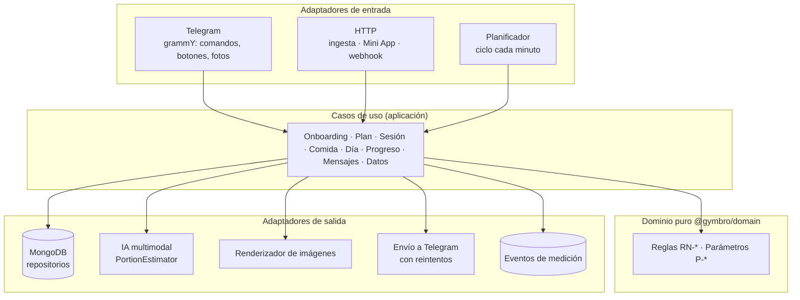
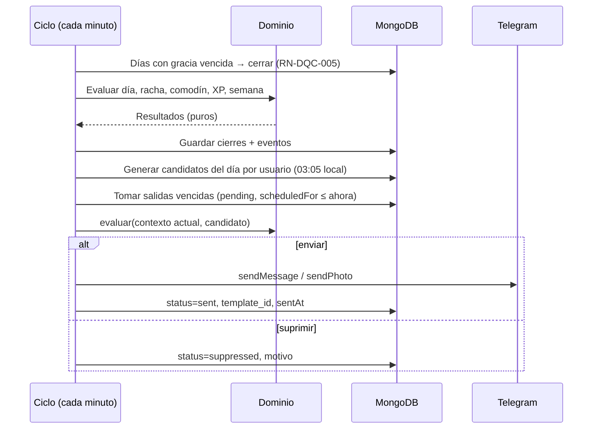

# Plan técnico · Fase 0

> Responde al **cómo** del paquete SDD. Las decisiones vienen de [[registro-de-decisiones]] (ADR-002, 006, 007, 013, 014, 015, 017). Las versiones exactas de librerías se fijan al iniciar el repositorio (usar la última estable y registrarla aquí).

## 1. Resumen

| Capa | Elección propuesta | Decisión |
|---|---|---|
| Lenguaje | TypeScript en todo el sistema (Node.js LTS) | ADR-015 |
| Bot | **grammY** (TypeScript; plugins de conversaciones, menús, sesiones, reintentos y límites de tasa) (`F72`) | ADR-015 |
| Dominio | Paquete puro `@gymbro/domain` sin E/S, con parámetros centralizados | ADR-007, Constitución VII |
| Persistencia | **MongoDB** (Atlas en la nube; contenedor local) con validación en la frontera (zod) | ADR-015 (Q8 respondida: MongoDB) |
| Planificador | Bandeja de salida en la base de datos + ciclo cada minuto en el mismo proceso | SPEC-007 |
| HTTP | Servidor ligero para el puente de ingesta, la API de la Mini App y el *webhook* de Telegram | SPEC-008 |
| Imágenes | Plantillas SVG → PNG en el servidor (muro, resumen) | ADR-013 |
| IA | Adaptador `PortionEstimator` sobre un modelo multimodal por API, salida validada por esquema | ADR-007 |
| Mini App | React + Vite + Tailwind; SDK web de Telegram (Should / Fase 1) | ADR-013 |
| Monorepo | pnpm *workspaces* | — |
| Pruebas | Vitest + fast-check (propiedades) + mongodb-memory-server | [[estrategia-de-pruebas]] |

## 2. Arquitectura (hexagonal)



**Regla de dependencias:** `domain` no importa nada de `app`, `adapters` ni librerías de E/S. Los casos de uso dependen de interfaces (puertos); los adaptadores las implementan.

## 3. Estructura del repositorio

```
gym-bro/                         ← raíz del repositorio y de Claude Code
├── CLAUDE.md                    ← instrucciones para Claude Code (importa la constitución)
├── .claude/
│   ├── rules/                   ← reglas por ruta (dominio, bot y contenido, mensajes y planificador, datos y seguridad)
│   └── skills/                  ← /implementar-spec · /cambiar-regla · /lint-trazabilidad · /ingest-wiki
├── herramientas/
│   ├── lint_trazabilidad.py     ← verificación de enlaces, fuentes, RN↔specs↔pruebas
│   └── generar_mapa_trazabilidad.py ← regenera el lienzo de Obsidian
├── vault/                       ← bóveda de Obsidian (raw · wiki · output)
└── app/                         ← código (lo crea Claude Code en H4)
    ├── package.json · pnpm-workspace.yaml · tsconfig.base.json
    ├── packages/
    │   ├── domain/              ← reglas puras
    │   │   └── src/
    │   │       ├── config/parameters.ts      ← réplica exacta de parametros.md
    │   │       ├── goals/ · plan/ · training/ · nutrition/
    │   │       ├── day/ · gamification/ · progress/
    │   │       ├── messaging/   ← motor de política (función pura)
    │   │       └── safety/
    │   └── content/             ← plantillas, logros, ejercicios, alimentos, alertas (JSON/TS versionado)
    ├── apps/
    │   ├── server/              ← un solo proceso desplegable
    │   │   └── src/
    │   │       ├── bot/         ← grammY: middleware, enrutador, menús, tarjetas
    │   │       ├── scheduler/   ← cierre de días/semanas, candidatos, envío de la bandeja
    │   │       ├── http/        ← ingesta, API de Mini App, webhook
    │   │       ├── usecases/    ← casos de uso por spec
    │   │       └── adapters/    ← mongo, ia, imágenes, telegram, eventos
    │   └── miniapp/             ← React + Vite + Tailwind (Should/Fase 1)
    └── infra/                   ← docker-compose (Mongo local) · .env.example
```

## 4. Mapa specs → módulos

| Spec | Dominio | Aplicación / adaptadores |
|---|---|---|
| SPEC-001 | `goals/`, `safety/` | `bot/onboarding`, `usecases/onboarding` |
| SPEC-002 | `plan/` | `usecases/plan`, `bot/today` |
| SPEC-003 | `training/` | `bot/session-card`, `usecases/session` |
| SPEC-004 | `nutrition/` | `bot/meals`, `adapters/ai` |
| SPEC-005 | `day/`, `gamification/` | `scheduler/close-day`, `usecases/day` |
| SPEC-006 | `progress/`, `goals/` | `adapters/images`, `bot/progress`, `miniapp` |
| SPEC-007 | `messaging/` | `scheduler/outbox`, `adapters/telegram-sender` |
| SPEC-008 | — | `http/ingestion`, `usecases/export` |
| SPEC-009 | `safety/` | `bot/middleware/risk`, `usecases/data-rights` |

## 5. Flujo de una actualización de Telegram

1. **Deduplicación:** se descarta un `update_id` ya procesado (registro con caducidad).
2. **Carga del usuario** y su estado (zona horaria, modo sin números, pausa).
3. **Detector de señales de riesgo** sobre todo texto libre (RN-SEG-007) → si coincide, respuesta de cuidado y fin.
4. **Enrutador:** comando · botón (`callback_data`) · foto · texto con intención del dominio · texto no reconocido (respuesta con botones).
5. **Caso de uso** → reglas del dominio → persistencia.
6. **Render:** editar el mensaje existente cuando se pueda (tarjeta de sesión, registro de comida).
7. **Eventos** de medición sin texto libre (RN-DAT-005).
8. Interacción → reinicia el contador de mensajes ignorados (RN-MSJ-007).

**Botones:** los datos que viajan en cada botón tienen un límite pequeño de tamaño (64 bytes según la referencia de la Bot API `[verificar al implementar]`); usar un formato compacto (`acción:entidad:id-corto[:arg]`) e identificadores cortos. Toda acción debe ser idempotente (NFR-03).

## 6. Planificador (motor de mensajes y cierres)



- **Re-evaluación al enviar:** una salida programada se vuelve a evaluar con el estado del momento (¿ya entrenó? ¿pausó?).
- **Salidas viejas** (por caída del servidor): se suprimen con motivo `stale`.
- **Bloqueo:** el error de Telegram por bot bloqueado → cancelar pendientes y `bot_blocked` (RN-MSJ-014).

## 7. IA acotada

- **Puerto:** `PortionEstimator.estimate(imagen | texto) → { componentes[], porciones{palm, cuppedHand, fist, thumb}, confianza, preguntaSugerida? }`.
- **Implementación:** modelo multimodal por API con instrucción fija y salida JSON validada con zod; si no valida, se descarta y se ofrece el teclado de porciones.
- **Límites:** P-068 fotos por día; tiempo máximo de respuesta; costo por llamada registrado en `photo_estimate_requested` (H13).
- **Privacidad:** la imagen se envía en memoria y no se guarda (RN-DAT-004); verificar la política de retención del proveedor antes de la alfa.
- **Nunca:** texto de recomendación al usuario (RN-SEG-010).

## 8. Imágenes de progreso

Plantillas SVG parametrizadas (muro de constancia, tarjeta de logro) renderizadas a PNG en el servidor y enviadas con `sendPhoto`. Opciones de renderizado a evaluar al iniciar: `@resvg/resvg-js` o `sharp` (verificar compatibilidad con la plataforma de despliegue).

## 9. Mini App (Should / Fase 1)

- Se abre desde el botón de menú del bot o un botón en línea (`F69`).
- El servidor **valida los datos de inicio** que Telegram entrega a la Mini App antes de responder, siguiendo el procedimiento de la documentación oficial (`F69`).
- Vistas: muro (52 semanas), bitácora, objetivo, gráficas de fuerza y proteína, temporizador de descanso con háptica.
- Hosting estático (por ejemplo, Netlify, que el fundador ya usa).

## 10. Configuración, entornos y despliegue

| Variable | Uso |
|---|---|
| `TELEGRAM_BOT_TOKEN` | Token de BotFather |
| `TELEGRAM_WEBHOOK_SECRET` | Secreto del *webhook* (producción) |
| `MONGODB_URI` | Conexión a la base |
| `AI_API_KEY` · `AI_MODEL` | Proveedor de IA (Should) |
| `INGESTION_TOKEN_PEPPER` | *Pepper* para el *hash* de tokens de ingesta |
| `APP_BASE_URL` | URL pública (ingesta, Mini App) |
| `DEFAULT_TZ` | `America/Bogota` |

| Entorno | Bot | Base | Notas |
|---|---|---|---|
| Local | *Long polling* | Mongo en Docker | Sin URL pública |
| Producción (Fase 0) | *Webhook* HTTPS (o *long polling* en un servidor siempre encendido) | MongoDB Atlas | Un contenedor Node siempre encendido (p. ej., Railway, Render, Fly.io o un VPS; **verificar costos vigentes**) |

## 11. Observabilidad y seguridad técnica

- Registros JSON estructurados con redacción de secretos y sin texto libre del usuario (RN-DAT-005, RN-DAT-006).
- Eventos de medición en su propia colección ([[plan-de-medicion]]).
- Usuario de base de datos con privilegios mínimos; copias de seguridad automáticas del proveedor.
- Límite de tasa en la ingesta; validación de esquemas en todas las entradas.

## 12. Riesgos técnicos

| Riesgo | Mitigación |
|---|---|
| Límites de envío de Telegram | Reintentos con espera exponencial (plugin de reintento automático de grammY) |
| Caída del proceso | Salidas persistentes + re-evaluación al reiniciar + supresión de salidas viejas |
| Errores de zona horaria | Todas las fechas en UTC en la base + día operativo calculado en el dominio con la zona del usuario |
| Toques duplicados | Claves de idempotencia por serie y comida |
| Latencia de la IA | Mensaje "Analizando…" editado al llegar la propuesta; tiempo máximo y alternativa manual |

## 13. Decisiones pendientes

- `[NEEDS CLARIFICATION: Q9]` Mini App en Fase 0 o Fase 1.
- `[NEEDS CLARIFICATION]` Proveedor y modelo de IA para la foto (decidir con la prueba de 20 comidas, H14, y el costo, H13).
- `[NEEDS CLARIFICATION]` Plataforma de despliegue.
