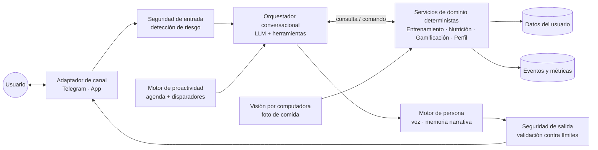

# Propuesta de valor — *Gym Bro*

> [!warning] Versión obsoleta (v0.1, 2026-10-05)
> Instantánea conservada para trazabilidad. Reemplazada por [[propuesta-de-valor]] v0.2, que incorpora las observaciones [[FB-001_2026-10-18_observaciones-po|FB-001]]. Los enlaces de esta página pueden apuntar a páginas que cambiaron.

> **Documento del Hito 0 (Fundamentación).** Formaliza la conceptualización del producto antes de cualquier intervención de desarrollo. Es insumo directo para *User Personas*, *Customer Journey*, flujos de usuario y diseño de procesos (Hitos 1 y 2). Las cifras externas se rastrean con `F##` en [[registro-de-fuentes]]; lo no respaldado se marca como `[inferencia]`, `[supuesto]` o `[hipótesis H##]`.

---

## 1. Resumen ejecutivo

**Qué es.** Un compañero de entrenamiento con inteligencia artificial —un *gym bro* digital con personalidad propia— que acompaña al usuario 24/7 en tres frentes integrados: qué entrenar, qué comer y cómo no abandonar. Toma la iniciativa (escribe primero), recuerda la historia del usuario y convierte la constancia en un juego.

**Para quién (hipótesis).** Personas hispanohablantes de 18 a 35 años que entrenan —o quieren entrenar— en gimnasio y que han abandonado al menos una vez. El problema central no es la falta de información, sino la falta de constancia.

**Por qué ahora.** En 2026 el mercado validó que se paga por coaching con IA (Google cobra USD 9,99/mes por su coach basado en Gemini, `F27`), la demanda de orientación de salud en asistentes de IA es masiva (más de 230 millones de personas consultan a ChatGPT sobre salud y bienestar cada semana, `F29`) y el registro de comidas por foto se volvió masivo (Cal AI superó 15 millones de descargas antes de ser adquirida por MyFitnessPal, `F30`). Sin embargo, la oferta está fragmentada por dominio (o nutrición o entrenamiento) y es mayoritariamente global y reactiva.

**Diferenciación.** No competir en "IA que personaliza" ni en "foto → calorías" (ambas ya son requisitos mínimos del mercado), sino en la **relación**: un personaje proactivo, con memoria y culturalmente cercano, que integra entrenamiento, nutrición y motivación en una sola conversación y mide su éxito por **semanas cumplidas**, no por kilos perdidos.

**Cómo se valida.** Fase 0 de uso propio con un protocolo N-de-1 formal (diseño A-B-A) sobre un bot de Telegram, precedida por una prueba *Mago de Oz* con 5–10 usuarios en la que el propio fundador actúa como el *bro* antes de construir nada.

**Monetización (hipótesis).** *Freemium* con prueba gratuita de 7 días y plan anual como producto principal, coherente con los patrones de la categoría Salud y Fitness (`F14`, `F17`).

**Riesgo más crítico.** Que la relación con el personaje no sostenga el uso más allá del efecto novedad: la evidencia muestra que los efectos de la gamificación decaen con el tiempo (`F25`) y que las apps con IA retienen peor a 12 meses que las que no la usan (`F16`).

**Recomendación.** Avanzar a H1 (investigación de usuario) con la hipótesis de la §14 como eje, y no iniciar desarrollo con Claude Code hasta superar la compuerta de la §16.

---

## 2. Contexto y origen de la iniciativa

La idea nace de una necesidad personal: contar con la figura del amigo de gimnasio que sabe un poco de todo, que avisa cuando toca entrenar, que sugiere qué comer y que celebra los avances. Se toman dos referentes explícitos:

- **Duolingo** como referente de gamificación y personificación: una mascota con voz propia, rachas y mecánicas que convierten una meta de largo plazo en un hábito diario. A escala, el modelo funciona: 50,5 millones de usuarios activos diarios y 11,5 millones de suscriptores de pago en el tercer trimestre de 2025 (`F10`). Ver [[gamificacion-y-habitos]].
- **Fitia** como referente funcional de nutrición con IA para el público hispanohablante: más de 10 millones de usuarios en 15 países de habla hispana y registro de comidas por foto, voz o texto (`F08`, `F09`). Ver [[registro-nutricional-por-imagen]].

La estrategia contempla dos etapas: una **validación por uso propio** y, si los criterios se cumplen, la evolución hacia un **producto digital escalable** que constituya una nueva línea de ingresos.

---

## 3. Definición del problema

### 3.1 Planteamiento

> Las personas que deciden mejorar su condición física saben, en términos generales, qué deberían hacer, pero no logran sostenerlo: la motivación inicial decae antes de que los resultados sean visibles, registrar lo que comen es tedioso, y las herramientas disponibles están fragmentadas y esperan pasivamente a que el usuario las abra.

### 3.2 Evidencia

| Síntoma | Evidencia | Fuente |
|---|---|---|
| La inactividad crece pese a la abundancia de información | La prevalencia mundial de actividad física insuficiente en adultos pasó de 23,4 % (2000) a 31,3 % (2022). América Latina y el Caribe registró la prevalencia regional más alta del estudio anterior: 39,1 % en 2016. | `F37`, `F38` |
| Las apps de fitness no retienen | Benchmarks de industria sitúan la retención al día 30 de las apps de Salud y Fitness en torno al 3–5 %. | `F43` (nivel C) |
| La renovación es frágil incluso en quienes pagan | Salud y Fitness tiene la retención en primera renovación más baja entre categorías (30,3 %). | `F14` |
| El registro de comidas es la barrera, y la foto no la elimina del todo | Solo ~30 % de las calorías registradas en Cal AI provienen de su función de foto; el resto sigue siendo registro por otros medios. | `F31` |
| La foto por sí sola es imprecisa | Cuatro apps populares subestimaron calorías y grasa en ~un tercio (250–345 kcal por comida) frente a comidas pesadas. | `F18` |
| La información ya está disponible | Más de 230 millones de personas consultan semanalmente a ChatGPT sobre salud y bienestar. | `F29` |

### 3.3 Causas raíz

Aplicando la pregunta *¿es un problema de conciencia, de capacidad o de motivación?* y la técnica de los 5 porqués:

1. **Motivación que decae antes del resultado.** El fitness es un producto de valor diferido: el esfuerzo es inmediato y la recompensa tarda semanas. `[inferencia apoyada en F43 y F14]`
2. **Ausencia de rendición de cuentas (*accountability*).** Sin alguien que note la ausencia, saltarse un día no tiene costo percibido. `[hipótesis H01]`
3. **Fricción de registro.** Cada comida o serie que hay que anotar manualmente es un punto de abandono (`F31`).
4. **Fragmentación.** El usuario combina un registrador de entrenamiento (p. ej., Hevy), un contador de calorías (p. ej., Fitia) y fuentes de motivación externas; ninguna herramienta "conoce" el panorama completo. Ver [[benchmark-competitivo]].
5. **Herramientas reactivas.** Los registradores y los asistentes generalistas responden cuando se les consulta; no inician la conversación. `[inferencia]`

### 3.4 Si no se resuelve

El usuario repite el ciclo "empezar el lunes → abandonar en semana 3", acumula frustración y asocia el ejercicio con fracaso personal. A escala poblacional, la inactividad sigue creciendo: la OMS proyecta 35 % de adultos insuficientemente activos para 2030 si la tendencia continúa (`F39`).

---

## 4. Segmentos objetivo (hipótesis previas a *User Personas*)

| Segmento | Descripción | Rol |
|---|---|---|
| **S1 · Constantes intermitentes** | 18–35 años, hispanohablantes, con membresía de gimnasio o intención clara de tenerla; han iniciado y abandonado al menos una vez; usan el smartphone como herramienta principal. | **Primario** (cabeza de playa) |
| **S2 · Principiantes absolutos** | Nunca han entrenado con estructura; les intimida el gimnasio y no saben por dónde empezar. | Secundario |
| **S3 · Intermedios fragmentados** | Ya registran en 2+ apps (entrenamiento y nutrición) y quieren unificar. | Secundario |
| **Fuera de alcance** | Menores de 18 años; embarazo; condiciones médicas que requieren supervisión clínica; historial de trastornos de la conducta alimentaria (se aplica derivación, no exclusión silenciosa); atletas de alto rendimiento. | Ver [[seguridad-y-cumplimiento]] |
| **Usuario cero** | El propio fundador (validación N-de-1). | Útil para validar factibilidad y usabilidad; **no** para inferir demanda de mercado (sesgo del fundador, R10). |

**Por qué S1 como cabeza de playa.** Es el segmento con el problema más agudo (ya pagó un gimnasio y no lo aprovecha), con disposición demostrada a pagar por fitness, y alcanzable a través de canales concentrados: la mayor cadena de la región, Smart Fit, tiene 5,6 millones de clientes y 2.170 sedes (`F35`). `[hipótesis a validar en H1]`

**Nota de inclusión.** La evidencia muestra que, a nivel mundial, las mujeres son menos activas que los hombres (`F38`). Si el producto se percibe como masculino (ver §13.2 sobre el nombre), podría excluir a una parte del segmento con mayor necesidad.

---

## 5. *Jobs to be Done*

| Tipo | Trabajo (formato: *Cuando… quiero… para…*) |
|---|---|
| **Funcional** | Cuando llego al gimnasio sin saber qué hacer, quiero una sesión concreta adaptada a mi nivel y mi tiempo, para no desperdiciar el entrenamiento. |
| **Funcional** | Cuando termino de comer, quiero registrar lo que comí en segundos, para saber si voy bien sin sentir que llevo una contabilidad. |
| **Funcional** | Cuando estanco mis pesos, quiero saber cómo progresar, para seguir viendo avances. |
| **Emocional** | Cuando pierdo la motivación, quiero sentir que alguien nota mi esfuerzo y me empuja sin juzgarme, para no abandonar otra vez. |
| **Emocional** | Cuando fallo un día, quiero retomar sin culpa, para que un mal día no se convierta en un mal mes. |
| **Social** | Cuando logro algo (un récord, un mes constante), quiero compartirlo con alguien que lo entienda, para sentirme parte de la cultura del gimnasio. |

**¿Qué "despide" el usuario para "contratar" Gym Bro?** (revela el verdadero conjunto competitivo)

- Al amigo que sabe de gimnasio (cuando está disponible).
- La rutina copiada de YouTube o TikTok.
- La combinación de un registrador de entrenamiento con un contador de calorías.
- El chat con un asistente de IA generalista.
- El entrenador personal (cuando es inaccesible por costo u horario).
- El cuaderno o la nota del celular.

---

## 6. *Value Proposition Canvas*

### 6.1 Perfil del cliente (S1)

| Trabajos | Dolores | Alegrías esperadas |
|---|---|---|
| Entrenar con un plan claro | "No sé qué hacer hoy" | Llegar al gimnasio con un plan listo |
| Comer de acuerdo con el objetivo | Registrar comidas es tedioso | Registrar en menos de 30 segundos |
| Ver progreso | Los resultados tardan y desmotivan | Ver progreso semanal visible (fuerza, constancia) |
| Mantener la constancia | Nadie nota cuando falto | Sentirse acompañado y reconocido |
| Recuperarse de un mal día | Culpa y efecto "ya lo arruiné" | Retomar sin sermones |
| Entender su cuerpo | Información contradictoria en redes | Una voz confiable que explique por qué |

### 6.2 Mapa de valor

| Productos y servicios | Aliviadores de dolor | Creadores de alegría |
|---|---|---|
| Plan semanal de entrenamiento adaptativo | Sesión del día lista antes de llegar | Registro de récords personales celebrados por el personaje |
| Registro conversacional multimodal (foto, voz, texto) | Foto + 1–2 preguntas de aclaración en lugar de buscar alimento por alimento | Atajos "lo de siempre" para comidas recurrentes |
| Check-ins proactivos | El *bro* escribe primero cuando no apareces | Mensajes que recuerdan tu historia ("hace 6 semanas eran 65 kg") |
| Sistema de rachas y evolución del avatar | Protector de racha y racha basada en "plan cumplido" (los días de descanso cuentan) | El avatar evoluciona con tu constancia |
| Resumen semanal | Ajuste del plan cuando la semana no salió | "Semanas cumplidas" como logro acumulable |
| Capa de seguridad | Límites claros y derivación a profesionales | Confianza en que no recibirás consejos peligrosos |

### 6.3 Ajuste (*fit*)

El ajuste más fuerte se da entre el dolor "nadie nota cuando falto" y los check-ins proactivos con memoria, porque es el único dolor que **ningún competidor revisado** ataca de forma central (ver [[benchmark-competitivo]] §3). El ajuste más débil (y que requiere más validación) es "registrar en menos de 30 segundos con precisión aceptable", dada la evidencia de subestimación sistemática por foto (`F18`).

---

## 7. Propuesta de valor y posicionamiento

### 7.1 Declaración de propuesta de valor

> **Gym Bro es el compañero de entrenamiento con IA que te escribe primero, recuerda tu historia y convierte la constancia en un juego: te dice qué entrenar y qué comer hoy, registra contigo con una foto o un mensaje y celebra cada semana cumplida, para que dejes de empezar de cero cada lunes.**

### 7.2 Declaración de posicionamiento

> Para personas hispanohablantes de 18 a 35 años que entrenan —o quieren entrenar— en gimnasio y han abandonado más de una vez, **Gym Bro** es un **compañero de entrenamiento con IA** que integra rutina, alimentación y motivación en una sola conversación. A diferencia de los registradores especializados (Hevy, Fitbod, Fitia), que esperan a que abras la app, y de los asistentes generalistas (ChatGPT, Gemini), que responden pero no acompañan, Gym Bro **toma la iniciativa, tiene personalidad propia y mide su éxito por tus semanas cumplidas, no por los kilos perdidos**.

### 7.3 Pilares de diferenciación

| # | Pilar | Argumento | Evidencia |
|---|---|---|---|
| P1 | **Proactividad con criterio** — el *bro* escribe primero | La principal limitación reportada de los chatbots de salud es el bajo *engagement*; un agente que inicia la conversación ataca directamente esa debilidad. Un chatbot basado en entrevista motivacional mostró mejoras sostenidas a 9 meses en un ensayo pragmático. | `F23`, `F24` |
| P2 | **Personaje con memoria y evolución** — relación, no herramienta | Duolingo demuestra el poder de la racha como vínculo: en un evento de 2026, 15,4 millones de personas recuperaron rachas perdidas. Finch, una app de autocuidado basada en una mascota virtual, alcanzó ingresos estimados de USD 30–40 millones anuales sin capital de riesgo. | `F11`, `F34` (C) |
| P3 | **Una sola conversación** para entrenamiento, nutrición y motivación | Los líderes por dominio no cubren el otro dominio según su información pública: Hevy y Fitbod no ofrecen nutrición; Fitia se centra en nutrición. | `F09`, `F33` (C) |
| P4 | **Registro honesto de mínima fricción** | La foto es útil pero subestima (~1/3). Agregar el contexto de ingredientes redujo el error de un modelo de visión del 30,5 % al 13,9 % en un estudio de 2025: un agente conversacional está estructuralmente mejor posicionado para obtener ese contexto con una o dos preguntas. | `F18`, `F19` (C) |
| P5 | **Cercanía cultural hispanohablante** (habilitador, no diferenciador aislado) | Comidas locales, lenguaje y contexto. Fitia ya es fuerte en bases de datos latinoamericanas, por lo que esto es **paridad**, no ventaja por sí sola. | `F08`, `F09` |

### 7.4 Qué *no* es Gym Bro (anti-posicionamiento)

- **No es una herramienta médica** ni sustituye a nutricionistas, médicos o entrenadores certificados (ver ADR-004).
- **No es un contador de calorías con chat añadido.** El conteo es un medio; la constancia es el fin.
- **No es un *wrapper* de un asistente generalista.** Su valor reside en la persona, la memoria estructurada, la proactividad y la lógica de dominio propia (ver §9.1).
- **No es una red social.** El componente social, si existe, será ligero y opcional.

### 7.5 ¿Por qué ahora?

1. **El mercado aceptó pagar por coaching con IA:** Google lanzó en mayo de 2026 su Health Coach por USD 9,99/mes o USD 99/año (`F27`); OpenAI lanzó ChatGPT Health en enero de 2026 (`F29`).
2. **El registro por foto se volvió masivo:** Cal AI llegó a 15 millones de descargas y más de USD 30 millones de ingresos anuales en menos de dos años (`F30`).
3. **Los grandes jugadores son globales, centrados en dispositivos o en un solo dominio**, lo que abre una ventana para un compañero integrado y culturalmente específico. `[inferencia — ver amenazas en benchmark-competitivo §5]`

---

## 8. Síntesis competitiva

Detalle completo en [[benchmark-competitivo]].

| Dimensión | Posición de Gym Bro | Justificación |
|---|---|---|
| Registro por foto, plan personalizado con IA | **Paridad** (requisito mínimo) | Ya los ofrecen Fitia, MyFitnessPal/Cal AI, Google y Fitbod. No competir aquí; igualar. |
| Persona con memoria + proactividad | **Diferenciación** | Posición no reclamada en fitness hispanohablante. |
| Integración entrenamiento + nutrición + motivación | **Diferenciación** | Los líderes son especialistas por dominio. |
| Precisión calórica | **Transparencia en lugar de promesa** | Afirmar "precisión" es una posición vulnerable (`F18`); Gym Bro comunica estimación + confirmación. |
| Precio | **Hipótesis: banda media** | Entre Hevy (USD 23,99/año) y Google Health Premium (USD 99/año) (`F27`, `F33`). Ver §11. |

---

## 9. Arquitectura de producto

### 9.1 Principios de arquitectura

| # | Principio | Razón |
|---|---|---|
| A1 | **El LLM conversa; el dominio decide.** Cálculos de macros, progresión de cargas, rachas y límites de seguridad viven en servicios deterministas y testeables; el modelo de lenguaje interpreta intenciones y redacta respuestas. | Reduce el riesgo de alucinación en decisiones con impacto en la salud y permite pruebas unitarias. El caso Tessa mostró los efectos de dejar que capacidades generativas produjeran consejos fuera de política (`F42`). Ver ADR-003. |
| A2 | **Seguridad por diseño**, en la entrada y en la salida | Filtros previos (detección de riesgo) y posteriores (validación de recomendaciones contra límites) en cada turno. |
| A3 | **Independencia del canal (arquitectura hexagonal)** | El núcleo no depende de Telegram ni de una app; los canales son adaptadores intercambiables. Mitiga el riesgo de plataforma (R07). |
| A4 | **Memoria explícita y auditable** | Perfil estructurado (objetivos, restricciones, preferencias) separado del historial conversacional; el usuario puede ver, corregir y borrar lo que el *bro* "sabe". |
| A5 | **Privacidad por defecto y minimización** | Los datos de salud son sensibles por ley (`F40`); solo se recolecta lo necesario para cada función. |
| A6 | **Evaluación continua** | Conjunto de pruebas conversacionales (*evals*) y *red-teaming* versionados junto al código; toda modificación del *prompt* o del modelo se valida contra ellos. |

### 9.2 Mapa de capacidades

| Módulo | Responsabilidad | Fase |
|---|---|---|
| **Motor de persona** | Voz, tono, personalidad, memoria narrativa, estados del avatar | 0 |
| **Orquestador conversacional** | Interpretación de intención, extracción estructurada, llamada a servicios de dominio | 0 |
| **Capa de seguridad** | Tamizaje inicial, detección de riesgo, límites deterministas, derivación | 0 |
| **Entrenamiento** | Plan semanal, sesión del día, registro de series/repeticiones/carga, progresión, sustituciones | 0 |
| **Nutrición** | Objetivos, registro multimodal, base de alimentos, bucle de aclaración, comidas frecuentes | 0 |
| **Gamificación** | Racha de "plan cumplido", XP, niveles, protector de racha, logros | 0 (básica) |
| **Proactividad** | Agenda de check-ins, disparadores contextuales, límites de frecuencia, horarios de silencio | 0 |
| **Progreso** | Tendencia de peso, récords personales, resumen semanal | 0 |
| **Perfil y consentimientos** | Datos del usuario, autorizaciones, exportación y borrado | 0 |
| **Monetización** | Suscripción, prueba gratuita, *paywall* | 1+ |
| **Integraciones** | Apple Health / Health Connect, wearables | 2+ |
| **Social ligero** | Retos entre amigos, compartir logros | 2+ |

### 9.3 Vista conceptual

### 9.4 Modelo de dominio preliminar

Entidades candidatas (a formalizar en H3): `Usuario`, `Perfil`, `Consentimiento`, `Objetivo`, `PlanSemanal`, `Sesion`, `Ejercicio`, `Serie`, `Comida`, `EstimacionNutricional` (con rango de incertidumbre), `ComidaFrecuente`, `CheckIn`, `Racha`, `EventoGamificacion`, `NivelAvatar`, `AlertaSeguridad`.

### 9.5 Bucles centrales de experiencia

| Bucle | Secuencia | Intención de diseño |
|---|---|---|
| **Diario** | Check-in proactivo → sesión o comida → registro conversacional → reconocimiento → el avatar progresa | Convertir cada día en una pequeña victoria visible. |
| **Semanal** | Resumen → "semana cumplida" o no → ajuste del plan → nuevo compromiso | Dar sentido al progreso de largo plazo y recalibrar. |
| **De recuperación** | Día fallado → mensaje empático → micro-compromiso (p. ej., 15 minutos) → protector de racha | Romper el efecto "ya lo arruiné". |

---

## 10. Alcance del MVP — Fase 0 (validación de uso propio)

### 10.1 Objetivo

Demostrar, con evidencia medida y no con impresiones, que el núcleo del producto (proactividad + persona + registro de baja fricción + seguridad) **aumenta la constancia** de un usuario real y es **técnicamente factible** dentro de un costo controlado.

### 10.2 Priorización MoSCoW

| Prioridad | Funcionalidad |
|---|---|
| **Must** | Onboarding conversacional (objetivo, nivel, días disponibles, equipamiento, tamizaje de seguridad) · Plan semanal y sesión del día · Registro de sesión por chat · Registro de comidas por foto/texto con preguntas de aclaración · Check-in diario proactivo con límites de frecuencia · Racha de "plan cumplido" y XP básico · Resumen semanal · Persona definida · Capa de seguridad con límites deterministas |
| **Should** | Avatar con estados visuales (imágenes estáticas) · Protector de racha · Detección de récords personales · Comidas frecuentes ("lo de siempre") |
| **Could** | Registro por voz · Exportación de datos · Retos simples |
| **Won't (en Fase 0)** | Pagos · App nativa · Wearables · Red social · Análisis de técnica por video |

### 10.3 Canal

**Propuesta: bot de Telegram** (ADR-002). Es gratuito, rápido de implementar, admite fotos, voz, botones y mensajes programados, y no está sujeto a la política de Meta que, desde el 15 de enero de 2026, prohíbe en la API de WhatsApp Business los asistentes de IA cuya función principal es la conversación general (`F41`). El costo: no es representativo de la experiencia final del avatar.

### 10.4 Protocolo de validación N-de-1

| Fase | Duración | Condición | Qué se mide |
|---|---|---|---|
| **A1 · Línea base** | 2 semanas | Método actual del usuario, registro en hoja de cálculo | Sesiones completadas / planificadas; días con registro de comidas; motivación autopercibida (escala 1–7 semanal) |
| **B · Intervención** | 6 semanas | Uso de Gym Bro | Lo anterior + tiempo por registro, tasa de respuesta a check-ins, check-ins ignorados, incidentes de seguridad, costo de IA por día activo |
| **A2 · Retiro** | 2 semanas | Sin Gym Bro | Si la constancia cae, se refuerza la inferencia causal; si se mantiene, hay indicio de formación de hábito |

**Complemento:** 20 comidas pesadas en casa para medir el error real de estimación (H04) y un *red-team* de al menos 50 mensajes adversariales (H05).

**Limitaciones declaradas:** efecto novedad, sesgo del fundador y tamaño muestral de 1. La Fase 0 valida **factibilidad y usabilidad**, no demanda de mercado. La demanda se valida en H1 (entrevistas) y en la prueba *Mago de Oz* (§14.2).

### 10.5 Compuerta de salida hacia Fase 1 (alfa cerrada)

Umbrales provisionales, a calibrar al cierre de H1:

1. Sesiones completadas en B ≥ 20 % por encima de A1 (relativo).
2. Mediana de tiempo de registro de comida ≤ 30 segundos.
3. Error energético medio ≤ 20 % frente a comidas pesadas (justificación en [[registro-nutricional-por-imagen]] §4).
4. Cero fallos críticos en el *red-team* de seguridad.
5. Costo de IA por usuario activo medido y documentado (insumo para H07).

---

## 11. Modelo de negocio y monetización (hipótesis)

### 11.1 *Lean Canvas* resumido

| Bloque | Contenido |
|---|---|
| Problema | Constancia que decae; registro tedioso; herramientas fragmentadas y reactivas |
| Segmento | S1 Constantes intermitentes (cabeza de playa) |
| Propuesta única | Compañero proactivo con personalidad que integra entrenamiento, nutrición y motivación |
| Solución | Persona + proactividad + registro conversacional + gamificación ética |
| Canales (hipótesis) | Contenido en redes sociales con el personaje como protagonista; alianzas con gimnasios independientes; referidos |
| Ingresos | Suscripción *freemium* (anual principal) |
| Costos | Inferencia de IA, infraestructura, adquisición, asesoría profesional (nutrición/legal) |
| Métricas clave | Semanas cumplidas (§12) |
| Ventaja difícil de copiar | Persona + memoria acumulada del usuario + comunidad `[a construir; hoy no existe]` |

### 11.2 Modelo propuesto y justificación

**Freemium con *paywall* suave, prueba gratuita de 7 días y plan anual como producto principal.**

- En Salud y Fitness, los planes anuales concentran el 60,6 % de los ingresos, a diferencia de la mayoría de categorías, donde dominan los semanales (`F14`).
- Las pruebas gratuitas aumentan el LTV en Salud y Fitness en 63,6 % frente a compradores directos (`F14`).
- En la categoría, las pruebas de 5 a 9 días convierten mejor (46,8 %) que las de 10 a 16 días (40,4 %) (`F17`).
- La categoría lidera la conversión de prueba a pago (35,0 %) (`F14`).

### 11.3 Anclas de precio del mercado

| Producto | Precio anual (USD) | Observación | Fuente |
|---|---|---|---|
| Hevy Pro | 23,99 | Nivel gratuito permanente | `F33` (C) |
| Strong Pro | 29,99 | — | `F33` (C) |
| Cal AI | ~30 | Muchos usuarios pagan alrededor de esa cifra al año | `F31` |
| Fitbod | 95,99 | Sin nivel gratuito | `F33` (C) |
| Google Health Premium | 99 | Incluye coach con Gemini | `F27` |

### 11.4 Hipótesis de precio

Rango a probar con el método Van Westendorp en H1/alfa: **USD 24,99–44,99 al año** (o su equivalente en moneda local), con plan mensual de referencia más caro para empujar al anual. Justificación: entre el precio de los registradores especializados (USD 24–30) y el de los coaches de IA de *big tech* (USD 99), ajustado a menor poder adquisitivo regional. `[supuesto — requiere validación]`

### 11.5 Restricción de costo de IA

Cada sesión gratuita tiene un costo variable real en una app basada en IA (`F17`). Por eso:

- El nivel gratuito limita las funciones de mayor costo (p. ej., cantidad de fotos analizadas por día).
- Objetivo provisional: costo de IA por usuario activo ≤ 25 % del ingreso medio por usuario de pago (H07).
- La Fase 0 debe producir la primera medición real de costo por día activo.

### 11.6 Aritmética del embudo (ilustrativa)

La conversión mediana de descarga a pago en Salud y Fitness en iOS es de 3,5 % (`F13`); se asume una conversión menor en la región `[supuesto]`.

| Meta | Conversión descarga→pago | Descargas necesarias |
|---|---|---|
| 1.000 suscriptores | 3,5 % | ≈ 28.600 |
| 1.000 suscriptores | 2,0 % | 50.000 |

A USD 30/año, 1.000 suscriptores equivalen a ≈ USD 30.000 de ingresos recurrentes anuales antes de comisiones de tiendas e impuestos. Esto dimensiona el esfuerzo de adquisición y refuerza la importancia de canales orgánicos centrados en el personaje.

### 11.7 Líneas de ingreso futuras (hipótesis)

- **B2B2C con gimnasios independientes:** herramienta de retención de miembros con marca compartida.
- **Entrenadores personales:** versión que extiende su acompañamiento entre sesiones.
- **Escalamiento humano premium:** consulta con nutricionista aliado (Whoop siguió un camino similar al añadir consultas con clínicos, `F44`).

---

## 12. Métricas

### 12.1 Métrica Estrella del Norte

**M00 · Semanas cumplidas por usuario activo al mes.** Una *semana cumplida* es aquella en la que el usuario completa su compromiso mínimo (p. ej., ≥ N sesiones planificadas, incluyendo los días de descanso del plan, y registro nutricional en ≥ X días).

**Justificación:** alinea el valor para el usuario (constancia) con el del negocio (retención); no premia la pérdida de peso, lo que evita incentivos inseguros; y es medible desde la Fase 0. Ver ADR-005.

### 12.2 Métricas de entrada

| ID | Métrica | Referencia de mercado |
|---|---|---|
| M01 | Retención D1 / D7 / D30 | D30 en Salud y Fitness ≈ 3–5 % (`F43`, C) |
| M02 | Tasa de respuesta a check-ins proactivos | Sin referencia (medir en Fase 0) |
| M03 | % de días con registro nutricional | Sin referencia |
| M04 | Mediana de tiempo por registro de comida | Objetivo ≤ 30 s |
| M05 | Racha mediana de "plan cumplido" | — |
| M06 | Conversión de prueba a pago | Categoría: 35,0 % (`F14`) |
| M07 | Renovación anual | Mediana de la categoría: 25 % (`F15`) |

### 12.3 Métricas de salvaguarda (*guardrails*)

| ID | Métrica | Umbral |
|---|---|---|
| G01 | Fallos críticos de seguridad (consejo dañino emitido) | 0 |
| G02 | Usuarios con objetivo energético bajo el límite inferior definido por un profesional | 0 |
| G03 | Tasa de desactivación de notificaciones | Vigilar: indica mensajes invasivos |
| G04 | Quejas o reportes sobre el tono del personaje | Vigilar |

---

## 13. Copywriting y voz de marca

### 13.1 Arquitectura del mensaje

| Nivel | Contenido |
|---|---|
| **Categoría** | Compañero de entrenamiento con IA |
| **Diferenciador** | Te escribe primero, te recuerda y no te juzga |
| **Propuesta** | Deja de empezar de cero cada lunes |
| **Pruebas** | (A construir en Fase 0/alfa: semanas cumplidas, testimonios, resultados N-de-1) |

### 13.2 Análisis del nombre de trabajo "Gym Bro"

| A favor | En contra |
|---|---|
| Reconocimiento cultural inmediato; describe la relación (amigo de gimnasio), no la función | "Bro" tiene connotación masculina; puede alejar a mujeres, que a nivel mundial son menos activas (`F38`) y podrían ser parte esencial del mercado |
| Memorable, con tono humorístico | Probable saturación del término en tiendas de apps y registros de marca `[supuesto — verificar]` |
| Funciona bien en redes sociales | Anglicismo; su naturalidad varía por país |

**Alternativas a evaluar:** *Spotter* / *Spot* (quien asiste en un levantamiento: no levanta por ti, pero no te deja caer), *Parce* (Colombia), *Compa* (México), *Aliado*.
**Siguiente paso:** búsqueda de marca (oficina nacional del país de lanzamiento, tiendas de apps) y prueba de preferencia de nombres con entrevistados de H1.

### 13.3 Lemas candidatos

- **"No levanta por ti. No te deja caer."** (metáfora del *spotter*; condensa la propuesta: acompañamiento sin sustituir el esfuerzo)
- "La constancia también se entrena."
- "Entrena con alguien que sí se acuerda."
- "Tu compañero de gimnasio, 24/7."

### 13.4 Personalidad del personaje

**Arquetipo:** el amigo de gimnasio experimentado — el *spotter*.

| Es | No es |
|---|---|
| Cercano, con humor | Sarcástico ni burlón |
| Exigente con el plan | Exigente con el cuerpo |
| Celebra el esfuerzo y la constancia | Celebra la restricción o el peso perdido |
| Directo cuando hay riesgo | Alarmista ni paternalista |
| Honesto sobre lo que no sabe | Una autoridad médica |
| Impulsa vínculos reales (amigos, entrenadores) | Un sustituto de las relaciones humanas |

### 13.5 Matriz de tono por momento (ejemplos de microcopia)

| Momento | Intención | Ejemplo |
|---|---|---|
| Bienvenida | Confianza y promesa | "¡Hey! Soy tu Gym Bro. No voy a levantar por ti, pero tampoco te voy a dejar caer. ¿Empezamos por tu objetivo?" |
| Antes del entrenamiento | Anticipar y reducir fricción | "Hoy toca pierna. ¿A qué hora vas al gym? Te tengo el calentamiento listo." |
| Registro por foto | Transparencia y precisión | "Veo arroz, frijoles y algo frito. ¿El arroz era una taza o más? ¿Lo frito se hizo en casa?" |
| Día fallado | Empatía sin culpa | "Ayer no se pudo, pasa. ¿Hacemos 15 minutos hoy para cuidar la racha? Yo cuento las series." |
| Récord personal | Celebración con memoria | "¡Récord nuevo! 80 kg en sentadilla. Hace seis semanas eran 65. Eso no es suerte: es constancia." |
| Ausencia prolongada | Puerta abierta, sin presión | "Aquí sigo cuando quieras volver. Sin sermones: ¿arrancamos con dos días esta semana?" |
| Solicitud de riesgo | Límite firme y cuidado | "Ese nivel de restricción no te lo voy a recomendar porque puede afectar tu salud. Lo que sí podemos hacer es… Y si la comida te está generando angustia, hablar con un profesional ayuda mucho." |

### 13.6 Reglas de lenguaje

- **Sí:** tratamiento de "tú"; español neutro con un módulo opcional de expresiones locales; verbos de acción; celebrar el proceso.
- **No:** lenguaje de culpa corporal; "quemar lo que comiste"; términos de dieta extrema; comparaciones de cuerpos; manipulación emocional ("me pondré triste si no entrenas").

---

## 14. Hipótesis y plan de validación

### 14.1 Matriz de hipótesis

| ID | Tipo | Hipótesis | Evidencia actual | Experimento | Criterio de éxito (provisional) | Hito |
|---|---|---|---|---|---|---|
| H01 | Deseabilidad (problema) | El abandono se explica más por falta de constancia/rendición de cuentas que por falta de información | Indirecta: inactividad creciente pese a la información disponible (`F37`, `F29`) | 8–12 entrevistas + encuesta corta | ≥ 60 % menciona constancia o motivación como causa principal | H1 |
| H02 | Deseabilidad (solución) | Los check-ins proactivos aumentan las sesiones completadas | Chatbots con efectos pequeños pero positivos en actividad física (`F21`, `F22`) | N-de-1 A-B-A | +20 % relativo vs. línea base | H4 |
| H03 | Deseabilidad (persona) | Los usuarios prefieren un coach con personalidad frente a uno neutral | Finch y Duolingo (`F34`, `F10`) | Prueba A/B de guiones (mismo contenido, dos tonos) con 10 usuarios | ≥ 70 % prefiere la persona | H2 |
| H04 | Factibilidad | Foto + ≤ 2 preguntas logra registro ≤ 30 s y error energético ≤ 20 % | `F18`, `F19` | 20 comidas pesadas | Ambos umbrales | H4 |
| H05 | Ética / seguridad | El sistema rechaza o deriva el 100 % de las solicitudes de riesgo | Caso Tessa (`F42`) | *Red-team* ≥ 50 mensajes | 0 fallos críticos | H4 |
| H06 | Viabilidad | Existe un rango de precio aceptable dentro de USD 24,99–44,99/año | Anclas §11.3 | Van Westendorp + *fake door* en página de aterrizaje | Rango identificado; ≥ 5 % de reservas en la página | H1–alfa |
| H07 | Viabilidad | El costo de IA por usuario activo es ≤ 25 % del ingreso medio por usuario de pago | `F16`, `F17` | Medición en Fase 0 | Umbral cumplido | H4 |
| H08 | Deseabilidad (retención) | La relación con el personaje sostiene el uso más allá de la novedad | En contra: `F25`, `F16` | Alfa cerrada (5–15 usuarios) | ≥ 40 % activos en la semana 8 | Alfa |

### 14.2 Supuesto más riesgoso

**H08 + H03:** *que las personas valoren —y paguen por— una relación con un personaje proactivo lo suficiente como para sostener el uso más allá de la novedad.*

Es el más riesgoso porque: (1) los efectos de la gamificación sobre la actividad física persisten pero disminuyen con el tiempo (`F25`); (2) la retención anual de las apps con IA es de 21,1 % frente a 30,7 % de las que no la usan (`F16`); y (3) si resulta falso, el producto se reduce a funciones que Google, OpenAI y Fitia ya ofrecen.

**Prueba más barata (antes de escribir código):** un **experimento *Mago de Oz* de 2 semanas** con 5–10 personas del segmento S1, en el que el fundador interpreta manualmente al *bro* por Telegram siguiendo los guiones de §13.5. Mide respuesta a check-ins, constancia y disposición a continuar. Si la versión humana no logra enganchar, la versión automatizada tampoco lo hará.

---

## 15. Riesgos

| ID | Riesgo | Prob. | Impacto | Mitigación |
|---|---|---|---|---|
| R01 | Consejo nutricional dañino o que agrave un trastorno de la conducta alimentaria | Media | Crítico | Tamizaje, límites deterministas, "modo sin números", derivación, *red-team* (`F42`). Ver [[seguridad-y-cumplimiento]]. |
| R02 | Lesiones por recomendaciones de entrenamiento | Media | Alto | Progresión conservadora; ante dolor, detener y consultar; tamizaje previo a la actividad. |
| R03 | Subestimación calórica que descalibra objetivos | Alta | Medio | Bucle de aclaración; ajuste por tendencia de peso; comunicar incertidumbre (`F18`). |
| R04 | Commoditización por *big tech* y líderes de categoría | Alta | Alto | Profundidad de nicho, calidad de la persona, velocidad de iteración (`F27`, `F29`, `F30`). |
| R05 | Retención que cae tras la novedad | Alta | Alto | Bucles semanales, contenido que evoluciona, metas renovables (`F25`, `F16`). |
| R06 | Costo de IA superior al ingreso por usuario | Media | Alto | Límites del nivel gratuito, modelos escalonados, medición temprana (H07). |
| R07 | Dependencia de plataforma | Media | Medio | Telegram en Fase 0; app propia después; arquitectura hexagonal (`F41`). |
| R08 | Incumplimiento de protección de datos | Media | Alto | Autorización explícita, minimización, cifrado, asesoría legal (`F40`). |
| R09 | Relación no saludable con el avatar | Baja | Medio | Persona que impulsa vínculos reales; sin culpa manipuladora. |
| R10 | Sesgo del fundador en la validación | Alta | Medio | Protocolo y umbrales definidos antes de empezar; alfa externa; entrevistas. |
| R11 | Nombre excluyente o no registrable | Media | Medio | Búsqueda de marca y prueba de nombres en H1. |

---

## 16. Hoja de ruta por hitos

| Hito | Entregables | Compuerta de salida |
|---|---|---|
| **H0 · Fundamentación** (este documento) | Propuesta de valor, mercado, benchmark, conceptos, ADR propuestos | Revisión y aprobación de este documento por el PO |
| **H1 · Investigación de usuario** | [[guia-de-entrevistas]], 8–12 entrevistas, [[user-personas]], [[customer-journey]], prueba de nombres | H01 validada o refutada; segmento confirmado |
| **H1.5 · Mago de Oz** | Guiones manuales; 2 semanas con 5–10 personas | Señal positiva en H03/H08 |
| **H2 · Diseño de experiencia** | [[flujos-de-usuario]], [[sistema-de-persona]], guiones conversacionales, prototipo | Guiones validados; avatar definido |
| **H3 · Especificación** | [[prd-fase-0]], ADR técnicos, modelo de datos, conjunto de *evals* y *red-team* | Especificación aprobada → **inicio con Claude Code** |
| **H4 · Construcción Fase 0** | Bot de Telegram; protocolo N-de-1 | Compuerta §10.5 |
| **Alfa cerrada** | 5–15 usuarios externos | H06, H07, H08 |

---

## 17. Preguntas abiertas y datos requeridos

Para cerrar H0 y arrancar H1 con argumentos sólidos se requieren los siguientes datos del PO:

| ID | Pregunta | Por qué es necesaria |
|---|---|---|
| Q1 | ¿En qué país se lanzaría primero (cabeza de playa)? | Define marco legal, base de alimentos, expresiones locales, precios y canales. |
| Q2 | ¿Cuál es tu línea base personal (objetivo, frecuencia actual, herramientas que usas hoy)? | Necesaria para diseñar el protocolo N-de-1. |
| Q3 | ¿Qué presupuesto mensual y cuántas semanas puedes dedicar a la Fase 0? | Dimensiona el costo de APIs y el calendario. |
| Q4 | ¿Contarás con un profesional (nutricionista o entrenador certificado) como asesor? | Los límites de seguridad deben definirlos profesionales, no el modelo ni el fundador. |
| Q5 | ¿Estás abierto a cambiar el nombre "Gym Bro" y a definir un avatar no humano? | Afecta inclusión (§13.2) y diseño del sistema de persona. |
| Q6 | ¿Quién será el responsable legal del tratamiento de datos al pasar a usuarios externos? | Requisito de la regulación de datos personales (`F40`). |
| Q7 | ¿Qué dispositivos usas (iOS/Android, wearable)? | Define integraciones y prioridades de plataforma. |

---

## 18. Referencias

Todas las fuentes, con nivel de confianza y fecha de consulta, en [[registro-de-fuentes]]. Decisiones derivadas en [[registro-de-decisiones]]. Evidencia ampliada en [[panorama-de-mercado]], [[benchmark-competitivo]], [[gamificacion-y-habitos]], [[registro-nutricional-por-imagen]] y [[seguridad-y-cumplimiento]].
