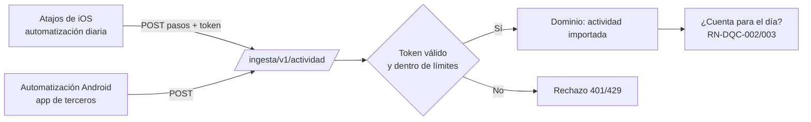

# Integraciones y ecosistema

> Responde a FB-001-05: *"ver cómo se conecta con otras apps y pasar más allá de un chatbot"*, con la restricción del PO de que **por ahora el producto es un bot de Telegram**.

## 1. Restricción técnica clave

Un bot de Telegram corre en un **servidor**, no en el teléfono del usuario. Por eso:

| Fuente de datos | ¿Accesible desde el bot? | Motivo |
|---|---|---|
| Health Connect (Android) | **No directamente** | Es un almacén en el dispositivo; se lee desde apps instaladas. La API en la nube de Google Fit cerró en 2025 (`F62`) |
| Apple Health (iOS) | **No directamente** | Igual: acceso desde apps nativas en el iPhone |
| Fitbit / Pixel Watch en la nube | **No en el corto plazo** | La API web de Fitbit cierra el 30-oct-2026 y, según un proveedor, Google pausó la incorporación de proyectos nuevos a su API de salud (`F63`, C) |
| Hevy | Sí, con la clave del usuario | API v1 con clave personal para usuarios Pro (`F73`, C) |
| Strava, Google Calendar | Sí, con OAuth | APIs en la nube `[verificar condiciones vigentes en H3]` |
| Atajos de iOS / automatizaciones de Android | Sí, mediante un *webhook* | El usuario configura un envío diario de pasos o entrenos a una URL con su token |

## 2. Escalera de integración

| Nivel | Qué | Para qué | Fase |
|---|---|---|---|
| 0 | **Exportar** todos los datos (CSV/JSON) con `/exportar` | Portabilidad, análisis N-de-1, confianza | 0 · Must |
| 1 | **Imágenes de progreso** generadas por el servidor | Ver el esfuerzo sin salir del chat | 0 · Must |
| 2 | **Mini App** en Telegram (botón de menú): progreso, bitácora, temporizador de descanso con háptica | Más allá del chat, dentro de Telegram (`F69`) | 0 · Should / 1 |
| 3 | **Puente de ingesta** (*webhook* con token por usuario): pasos y actividades | Que el día cuente con datos pasivos | 0 · Could / 1 |
| 4 | **Fuentes nube a nube:** Hevy (entrenos), Strava (cardio), Google Calendar (agendar sesiones) | Menos registro manual; anclar el hábito al calendario | 1 |
| 5 | **App nativa** con Health Connect y Apple Health | Lectura directa de datos de salud | 2+ — solo si se valida la necesidad (H10, R14) |

## 3. Puente de ingesta (diseño)

- **Token por usuario**, revocable con `/ajustes` → "Conexiones" (RN-INT-003).
- Los datos importados **no sobrescriben** registros manuales; duplicados del mismo tipo en ±30 min se resuelven a favor del registro de Gym Bro (RN-INT-004).
- Guía paso a paso para el usuario: pendiente según su dispositivo (Q6).

## 4. Mini App

- **Qué es:** una aplicación web que se abre dentro de Telegram desde el botón de menú del bot o un botón en línea (`F69`).
- **Qué aporta:** muro interactivo, línea de tiempo de logros, gráficas de fuerza y proteína, temporizador de descanso con vibración (háptica), pantalla completa y acceso directo en la pantalla de inicio del teléfono (`F69`).
- **Seguridad:** los datos de inicio que Telegram entrega a la Mini App deben **validarse en el servidor** antes de usarse (`F69`).
- **Encaje con el equipo:** se construye con React y Tailwind, el stack del fundador.

## 5. Monetización en el canal

En bots y Mini Apps, los bienes y servicios digitales deben cobrarse en **Telegram Stars**; los bots deben atender `/paysupport` y gestionar reembolsos (`F70`). Afecta el modelo de negocio de la Fase 1 (ver [[propuesta-de-valor]] §13).

## 6. Si en el futuro se construye una app nativa

Requeriría módulos nativos para Health Connect y Apple Health (no funcionan en Expo Go; necesitan *development build*), según un desarrollador que lo documentó (`F80`, C). Android domina en Colombia con ~78,5 % de los móviles (`F64`), por lo que Health Connect sería la primera integración nativa. Decisión diferida (ADR-014).
