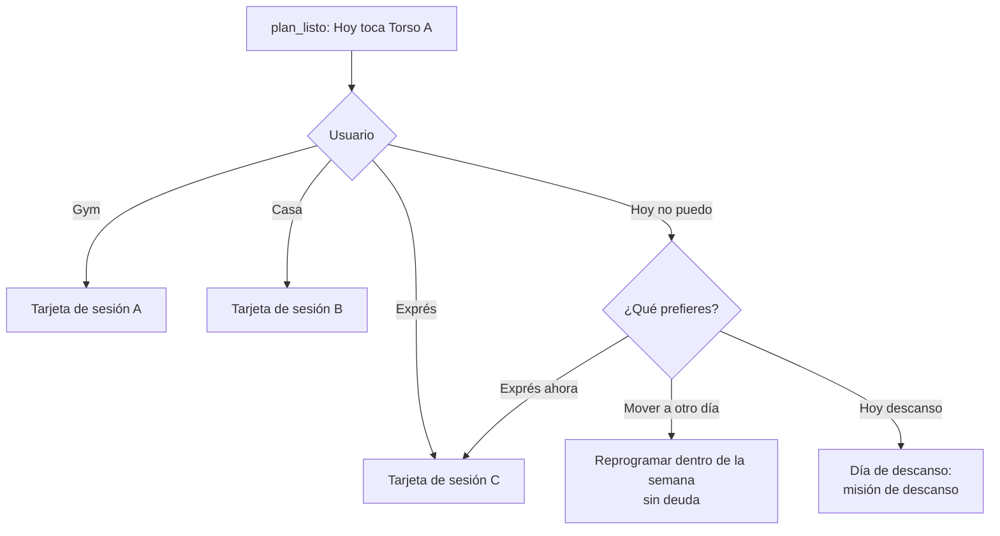

# Constancia en cualquier lugar

> Responde a FB-001-13: *"No todo centrarlo en el gym: recomendar y felicitar el ejercicio en casa en caso de que no pueda ir; lo más importante es no perder la consistencia."* y a JTBD-05.

## 1. Principio

> **Mejor 15 minutos hoy que la sesión perfecta que nunca pasó.** La constancia vale más que el lugar y que la intensidad de un día.

## 2. Tres versiones de cada sesión

| Versión | Dónde | Duración | Equipamiento | Cuenta para el día | XP |
|---|---|---|---|---|---|
| **A · Gym** | Gimnasio | La elegida por el usuario (30–90 min) | Máquinas, barras, mancuernas | Sí | 50 |
| **B · Casa** | Casa o parque | Igual a A | El perfil de equipamiento del usuario | Sí | 50 |
| **C · Exprés** | Cualquier lugar | 15–20 min | Peso corporal | Sí | 30 |

Las tres se generan **a la vez** con el plan (RN-PLAN-003): el usuario elige en el momento, sin configurar nada. La versión B vale lo mismo que la A en XP porque el producto premia la constancia, no el lugar.

**Perfiles de equipamiento en casa:** sin equipo · bandas elásticas · mancuernas o kettlebell · barra de dominadas.

## 3. Equivalencias por patrón de movimiento

Cada ejercicio del gym tiene una alternativa en casa que trabaja el **mismo patrón** (catálogo en [[catalogo-de-ejercicios-base]]):

| Patrón | Gym (A) | Casa (B) | Exprés (C) |
|---|---|---|---|
| Sentadilla | Sentadilla con barra | Sentadilla búlgara o *goblet* | Sentadilla con peso corporal |
| Bisagra de cadera | Peso muerto rumano | Peso muerto a una pierna con mochila | Puente de glúteo |
| Empuje horizontal | Press de banca | Flexiones (con variante de dificultad) | Flexiones |
| Tirón horizontal | Remo con barra | Remo con banda o remo invertido bajo una mesa firme | Remo invertido o "superman" |
| Empuje vertical | Press militar | Flexiones en pica | Flexiones en pica |
| Tirón vertical | Jalón al pecho | Dominadas o banda | — |
| Núcleo | Plancha con carga | Plancha y variantes | Plancha |

## 4. Evidencia

| Hallazgo | Implicación | Fuente |
|---|---|---|
| En personas no entrenadas, las cargas bajas produjeron ganancias sustanciales de fuerza e hipertrofia, aunque las cargas altas mostraron una tendencia no significativa a ser mejores | La sesión en casa es un estímulo válido para el usuario cabeza 01 | `F53` |
| Una revisión de 2021 propone que la hipertrofia se logra en un rango amplio de cargas si las series se llevan cerca del fallo | En casa, compensar la carga baja con series más cercanas al fallo `[VALIDAR-PROFESIONAL]` | `F54` (pendiente de verificar el texto completo) |
| En población joven, la fuerza y el tamaño muscular se mantuvieron hasta 32 semanas con 1 sesión semanal si se conservaba la intensidad | Una semana con versiones B o C no borra lo ganado | `F52` |
| La OMS recomienda actividades de fortalecimiento muscular 2 o más días por semana | Base del compromiso mínimo de mantenimiento | `F39` |

## 5. "Hoy no puedo ir" (flujo)

- **Sin deuda:** una sesión fallada no se acumula ni se duplica; la rotación sigue (RN-PLAN-007).
- **Reprogramar** solo dentro de la semana y respetando el descanso mínimo (RN-PLAN-008).

## 6. Celebración

La casa y la exprés se celebran **igual**: mismo "Día que cuenta n.º N", mismo lugar en el muro. Mensaje tipo: *"Exprés en casa: 15 minutos que cuentan igual. 🔥 10"*. Nunca: "no es lo mismo que el gym".

## 7. Medición

| Métrica | Hipótesis |
|---|---|
| M06 · % de días que cuentan desde B o C | H06 |
| % de "Hoy no puedo" que terminan en B/C vs. en día perdido | H06 |
