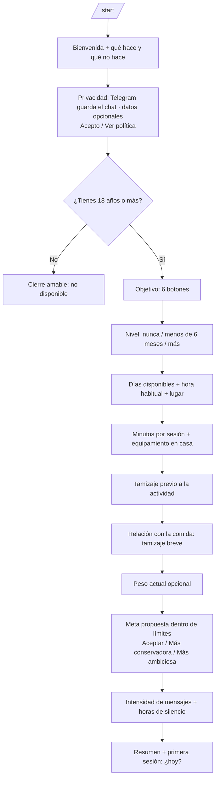
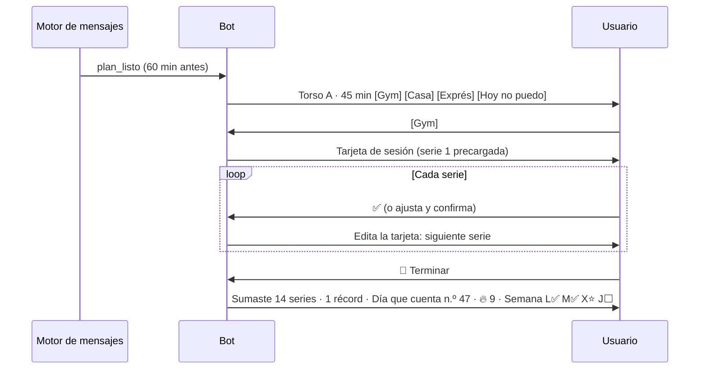
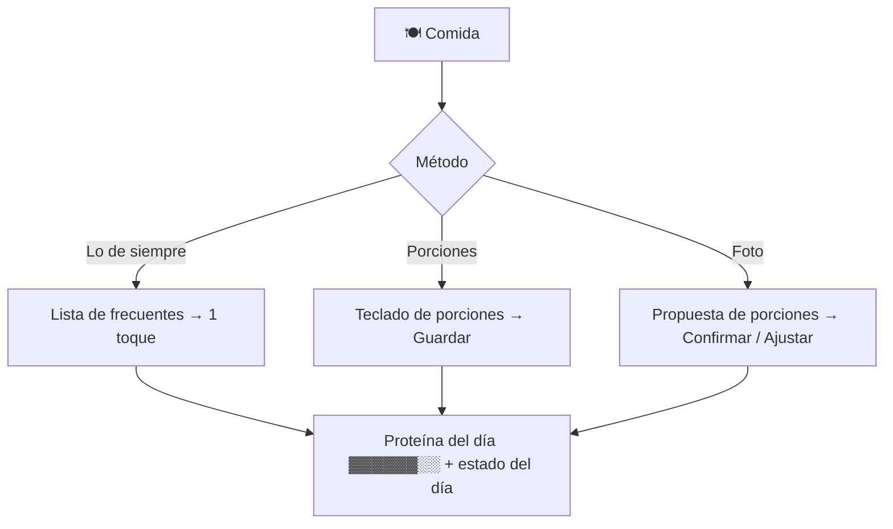
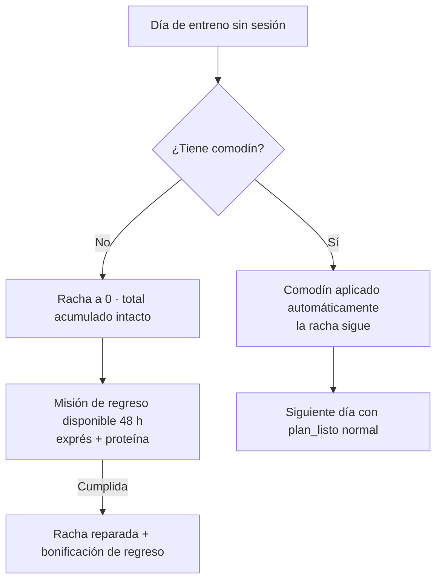

# Flujos de usuario (bot de Telegram)

> Base para el diseño conversacional estructurado de la Fase 0. El bot **no conversa**: guía con botones y comandos (ADR-006). Los textos definitivos están en [[plantillas-de-mensajes]].

## 1. Arquitectura de información

| Elemento de Telegram | Uso en Gym Bro | Fase |
|---|---|---|
| `/start` (con enlace profundo opcional) | Onboarding | 0 |
| **Teclado persistente** | `🏋️ Hoy` · `🍽️ Comida` · `📈 Progreso` | 0 |
| **Comandos** (menú `/`) | `/hoy` `/plan` `/comida` `/progreso` `/logros` `/ajustes` `/pausa` `/exportar` `/privacidad` `/borrar_datos` `/ayuda` | 0 |
| **Botones en línea** | Todas las decisiones y registros | 0 |
| **Edición de mensajes** | Tarjeta de sesión y registro de comida en un solo mensaje | 0 |
| **Imágenes enviadas por el bot** | Muro de constancia, resumen semanal, logros | 0 |
| **Botón de menú → Mini App** | Progreso interactivo y bitácora (`F69`) | 0 Should / 1 |

## 2. Manejo de lo que el usuario escribe

| Entrada | Ruta |
|---|---|
| Foto | Flujo de comida por foto (Should); si está apagado, sugerir porciones |
| Texto con palabras de riesgo (lista de [[seguridad-y-cumplimiento]]) | **Respuesta de cuidado predefinida** + derivación (RN-SEG-007) — tiene prioridad sobre todo |
| "No puedo", "hoy no", "no alcanzo" | Opciones de "Hoy no puedo" |
| Texto que describe comida | Propuesta de porciones (Could) o teclado de porciones |
| Peso ("68,5") tras `/progreso` → "Registrar peso" | Registro de peso |
| Cualquier otra cosa | Respuesta corta con los botones principales: "Funciono con botones: ¿qué quieres hacer?" |

## 3. Flujos principales

### F1 · Onboarding (≤ 3 min, ≈ 20 toques)

### F2 · Día de entreno

### F3 · Registro de comida

### F4 · Día de descanso
Mensaje de la mañana solo si el presupuesto lo permite y el usuario lo tiene activado: *"Hoy es descanso: tu misión es la proteína o 20 minutos de caminata."* El día cuenta cuando se cumple cualquiera de las dos (RN-DQC-003).

### F5 · Día fallado → regreso

### F6 · Objetivo cumplido → mantenimiento
Celebración + logro en la bitácora + capítulo cerrado → botones [Mantener] [Nueva meta]. Sin respuesta en 7 días → mantenimiento (RN-MAN-001).

### F7 · Resumen semanal (domingo 19:00)
Imagen del muro + semana vs. semana anterior + misiones nuevas + plan de la próxima semana con [Ver plan] [Ajustar días].

### F8 · Señal de riesgo
Texto con palabras de alerta → respuesta de cuidado predefinida (sin IA) → recursos y sugerencia de hablar con un profesional → registro del evento solo con su categoría (RN-SEG-007, RN-DAT-005).

## 4. Inventario de mensajes clave

| ID | Mensaje | Spec |
|---|---|---|
| MS-01 | Bienvenida | [[spec-001-onboarding-y-objetivo]] |
| MS-02 | Privacidad y consentimiento | [[spec-009-seguridad-y-privacidad]] |
| MS-03 | Meta propuesta | [[spec-001-onboarding-y-objetivo]] |
| MS-04 | Plan semanal | [[spec-002-plan-y-sesion-del-dia]] |
| MS-05 | Plan listo | [[spec-007-proactividad-y-mensajes]] |
| MS-06 | Tarjeta de sesión | [[spec-003-registro-de-entrenamiento]] |
| MS-07 | Cierre de sesión | [[spec-005-dia-que-cuenta-y-gamificacion]] |
| MS-08 | Registro de comida | [[spec-004-registro-de-nutricion]] |
| MS-09 | Resumen semanal | [[spec-006-progreso-logros-y-mantenimiento]] |
| MS-10 | Bitácora | [[spec-006-progreso-logros-y-mantenimiento]] |
| MS-11 | Respuesta de cuidado | [[spec-009-seguridad-y-privacidad]] |
