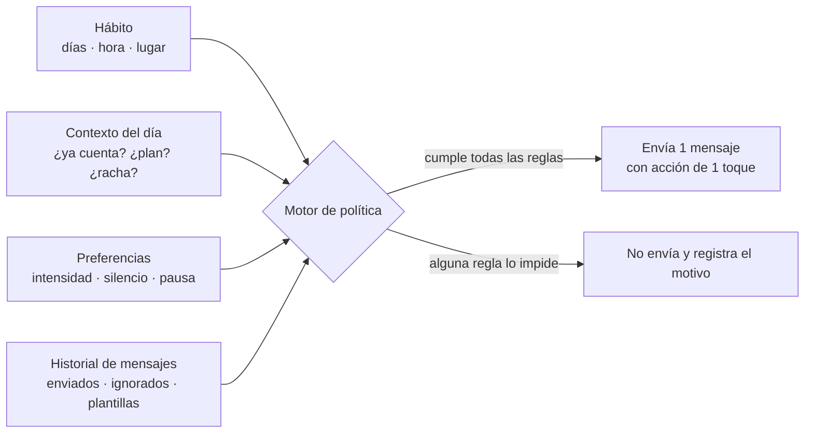

# Proactividad sin spam

> Responde a FB-001-22: *"Conocer su hábito del gym para tener listo ese plan; nuestro valor más fuerte es no esperar a que escriba sino escribir, sin llegar a ser intenso como un spam."* Reglas: RN-MSJ en [[reglas-de-negocio]]; textos en [[plantillas-de-mensajes]].

## 1. Por qué escribir primero

- Atar la acción a un cuándo y un dónde tuvo un efecto medio de d = 0,65 en 94 pruebas (`F47`): el "plan listo" a la hora del hábito convierte la intención en una acción concreta.
- Quien entrena solo no tiene a nadie que le escriba "¿vamos hoy?" (FB-001-09).

## 2. Por qué no abrumar

- Las sugerencias proactivas pierden efecto con el tiempo: en HeartSteps el efecto de las sugerencias de caminar se deterioró a lo largo del estudio (`F49`).
- Repetir el mismo mensaje rinde menos; el efecto se recupera con el tiempo (`F50`).
- Duolingo no aumenta la cantidad de notificaciones sin una justificación fuerte, porque una baja suele ser permanente (`F51`).
- Los datos públicos sobre "cuántas notificaciones son demasiadas" son contradictorios y de baja calidad (`F74`, C). **Conclusión:** no hay un número mágico; el presupuesto debe ser **conservador, medible y ajustable**.

> [!note] Particularidad de Telegram
> El usuario puede **silenciar** el chat del bot (no es detectable) o **bloquearlo** (sí es detectable: el envío falla). Silenciar desactiva el valor más fuerte del producto sin que nos enteremos; por eso el presupuesto es estricto y se mide la tasa de acción, no solo la de bloqueo.

## 3. Modelo

**Todos** los mensajes no solicitados pasan por este motor (RN-MSJ-015). Ninguna otra parte del sistema puede enviar un mensaje proactivo.

## 4. Propósitos permitidos

| Propósito | Cuándo | Condición | Acción de 1 toque |
|---|---|---|---|
| `plan_listo` | 60 min antes de la hora habitual, en día de entreno | La sesión no ha empezado | [Gym] [Casa] [Exprés] [Hoy no puedo] |
| `recordatorio_contextual` | Señal útil del contexto (ej.: ayer faltó y hoy tiene un hueco) | Presupuesto disponible | [Exprés 15'] |
| `cierre_del_dia` | 20:00 | El día **todavía no cuenta** y falta poco (ej.: solo la proteína) | [Lo de siempre] [Porciones] |
| `reconocimiento` | Al cerrar un capítulo, nivel o temporada fuera de la sesión | Una vez por logro | [Ver bitácora] |
| `resumen_semanal` | Domingo 19:00 | Siempre (1 por semana) | [Ver mi semana] |
| `regreso` | Tras 2 días de entreno planificados sin actividad | Máximo según RN-MSJ-008 | [Exprés 15'] [Ajustar plan] |
| `mantenimiento` | La media de peso salió de la banda 2 semanas | Solo en modo mantenimiento | [Ver opciones] |

**Prohibido:** mensajes genéricos ("te extrañamos"), de culpa, sobre el cuerpo o el peso de un día, y cualquier mensaje sin acción.

## 5. Reglas del motor (resumen)

| Regla | Valor por defecto | ID |
|---|---|---|
| Presupuesto (intensidad Normal) | ≤ 2 por día de entreno · ≤ 1 por día de descanso · ≤ 8 por semana (incluido el resumen) | RN-MSJ-002 |
| Intensidad Baja / Alta | ≤ 4 / ≤ 12 por semana | RN-MSJ-002 |
| Separación mínima | 3 h | RN-MSJ-003 |
| Horas de silencio | 21:30–07:00 (configurables) | RN-MSJ-004 |
| Hora habitual | Mediana de las últimas 6 sesiones por día de la semana; si no hay datos, la declarada | RN-MSJ-006 |
| Retroceso | 3 mensajes seguidos sin interacción → presupuesto a la mitad por 7 días | RN-MSJ-007 |
| Inactividad | 2 días planificados sin actividad → 1 `regreso`; 7 días → `regreso` final y pausa; reactivación solo con un nuevo comienzo (lunes o día 1), máximo 3 veces | RN-MSJ-008 |
| Desvanecimiento | Tras 8 semanas cumplidas seguidas, `recordatorio_contextual` se apaga; `plan_listo` sigue si su tasa de acción ≥ 50 % | RN-MSJ-009 |
| Rotación | La misma plantilla no se repite en 7 días | RN-MSJ-010 |
| Pausa | `/pausa` de 1 a 14 días | RN-MSJ-013 |
| Bloqueo | Si Telegram informa bloqueo, se detienen los envíos | RN-MSJ-014 |

## 6. Intensidad según la etapa

| Etapa ([[estrategia-anti-novedad]] §4) | Mensajes típicos por semana | Énfasis |
|---|---|---|
| Enganche (días 1–7) | 6–8 | Plan listo, primeros logros |
| Consolidación (días 8–66) | 5–7 | Plan listo, regreso, resumen |
| Autonomía (día 67+) | 3–5 | Resumen y reconocimientos; menos recordatorios |
| Mantenimiento | 2–4 | Resumen y temporadas de maestría |

## 7. Controles del usuario

- `/ajustes` → intensidad (Baja · Normal · Alta), horas de silencio, propósitos activados.
- `/pausa` → 1, 3, 7 o 14 días.
- Cada mensaje proactivo incluye, cada cierto tiempo, el atajo "¿Muchos mensajes? Ajusta aquí".

## 8. Medición

| Métrica | Definición | Uso |
|---|---|---|
| Tasa de acción | Mensajes seguidos de una acción en ≤ 2 h / enviados (por propósito y plantilla) | Calidad del mensaje |
| Tasa de bloqueo (G03) | Usuarios que bloquean / usuarios activos (mensual) | Salvaguarda del canal |
| Uso de `/pausa` (G04) | Pausas / usuarios activos | Señal de exceso |
| Mensajes no enviados por regla | Conteo por motivo | Verificar que el motor protege |
| Sesiones iniciadas desde `plan_listo` | % de sesiones | H02 |
