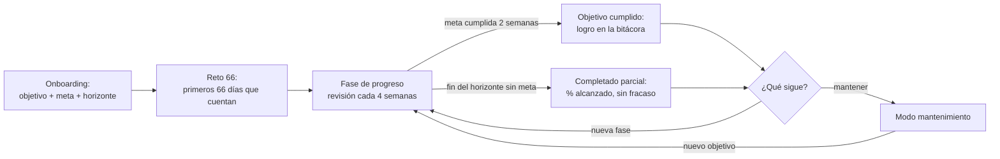

# Objetivos, progreso y mantenimiento

> Responde a FB-001-20 ("¿cuál es el objetivo del usuario?"), FB-001-21 ("el progreso debe tener un objetivo") y FB-001-10 ("¿qué pasa cuando ya cumplió el objetivo?"). Las reglas formales están en [[reglas-de-negocio]] (RN-OBJ, RN-MAN) y los valores en [[parametros]].

## 1. Principio

> **Todo progreso se mide contra una meta con fecha. Medimos a diario lo que el usuario controla y celebramos cada mes lo que cambia.**

Un objetivo sin métrica ni horizonte no se puede celebrar ni ajustar; un objetivo medido solo por resultados (kilos) desmotiva en las semanas en que todavía no hay cambios visibles. Por eso cada objetivo combina **una meta de resultado** con **indicadores de proceso** que se mueven todos los días ([[cada-dia-cuenta]]).

## 2. Catálogo de objetivos (Fase 01)

| Objetivo | Métrica principal | Indicadores de apoyo | Meta propuesta por defecto | Límite de seguridad |
|---|---|---|---|---|
| `ganar_musculo` | Peso corporal (media de 7 días) | 1RM estimado en 2–3 ejercicios clave; proteína | Ritmo de +0,25 %/semana (novato: hasta +0,5 %) | ≤ +0,5 %/semana (`F59`) `[VALIDAR-PROFESIONAL]` |
| `perder_grasa` | Peso corporal (media de 7 días) | Cintura; fuerza (mantenerla); proteína | Ritmo de −0,5 %/semana | ≤ −1,0 %/semana (`F58`); IMC meta ≥ 18,5 `[VALIDAR-PROFESIONAL]` |
| `ganar_fuerza` | 1RM estimado en 1–3 ejercicios elegidos | Repeticiones; volumen | +10 % de e1RM en 12 semanas `[supuesto, VALIDAR-PROFESIONAL]` | Progresión doble conservadora (RN-ENT-002) |
| `recomposicion` | Cintura con peso estable (±1 %) | 1RM estimado; proteína | −2 cm de cintura en 12 semanas `[supuesto]` | Igual que perder grasa |
| `ser_constante` | Semanas cumplidas | Días que cuentan | 10 de 12 semanas | — |
| `mantener` | Permanencia en la banda de peso y compromiso semanal | Días que cuentan; fuerza | Banda ± 2 % durante 12 semanas renovables | Ver §8 |

**Cómo se propone la meta:** el sistema calcula una meta a partir del peso actual, el ritmo por defecto y el horizonte (12 semanas por defecto, entre 4 y 24). El usuario puede ajustarla con botones (más conservadora o más ambiciosa), pero **nunca más allá de los límites** (RN-OBJ-004, RN-OBJ-005). Si una meta pedida no es segura, el sistema propone un horizonte más largo en lugar de rechazarla sin alternativa.

> Ejemplo: Mateo pesa 68 kg y quiere ganar músculo. Ritmo por defecto 0,25 %/semana × 12 semanas → meta ≈ 70 kg. Si pide 78 kg en 12 semanas (≈ 1,2 %/semana), el sistema responde que es más de lo que su cuerpo puede convertir en músculo y le propone 70–71 kg en 12 semanas o 78 kg como meta de varias fases.

## 3. Tres capas de medición

| Capa | Frecuencia | Indicadores | Cómo se muestra |
|---|---|---|---|
| **Proceso** | Diaria | Días que cuentan, sesiones completadas, proteína del día | Mensaje al cerrar sesión o comida; contador; muro |
| **Rendimiento** | Semanal | 1RM estimado, repeticiones, volumen, récords | Resumen semanal; récords en la bitácora |
| **Resultado** | Cada 2–4 semanas | Peso (media de 7 días), cintura | Revisión de fase; barra de progreso del objetivo |

**Por qué tres capas:** la automaticidad de un hábito tomó una mediana de 66 días (`F45`); durante ese tiempo el resultado se mueve poco y el usuario necesita evidencia diaria de que su esfuerzo suma.

## 4. Fórmulas

| Concepto | Fórmula | Regla |
|---|---|---|
| Media móvil de peso | Promedio de los pesos de los últimos 7 días (requiere ≥ 3 registros; si no, "datos insuficientes") | RN-OBJ-010 |
| Ritmo semanal | (media7 de hoy − media7 de hace 7 días) ÷ media7 de hace 7 días | RN-OBJ-004 |
| 1RM estimado (Epley) | peso × (1 + repeticiones ÷ 30), solo con ≤ 10 repeticiones | RN-ENT-005 |
| Progreso del objetivo | (actual − inicial) ÷ (meta − inicial), acotado entre 0 y 100 % | RN-OBJ-011 |
| Semana cumplida | Sesiones completadas ≥ compromiso (planificadas − 1 si son 3 o más) | RN-GAM-004 |

**Nunca se destaca la variación de un solo día** del peso: oscila por agua, sal y digestión, y mostrarla genera ansiedad sin informar (RN-OBJ-010).

## 5. Recorrido del usuario

- El **Reto 66** corre en paralelo a la primera fase: cuenta días acumulados, no consecutivos ([[sistema-de-gamificacion]]).
- **Revisión cada 4 semanas:** si el ritmo está fuera de los límites, el sistema propone ajustes (por ejemplo, si pierde más del 1 % semanal, sugiere comer más), siempre con opciones y sin alarma.

## 6. Estados del objetivo y lenguaje

| Estado | Cuándo | Mensaje tipo |
|---|---|---|
| `activo` | En curso | "Vas en el 40 % de tu meta. Sigue sumando días." |
| `cumplido` | Meta alcanzada y sostenida 2 semanas | "Lo lograste. Esto queda en tu bitácora." |
| `completado_parcial` | Fin del horizonte sin alcanzar la meta | "Llegaste al 70 % de tu meta en 12 semanas. ¿Extendemos o ajustamos?" |
| `cambiado` | El usuario eligió otro objetivo | (sin mensaje de cierre negativo) |
| `pausado` | El usuario pausó (viaje, lesión, exámenes) | "Tu objetivo queda en pausa. Tus días que cuentan no se pierden." |

**Prohibido:** "fallaste", "no cumpliste", "perdiste tu progreso" o cualquier variante (FB-001-17).

## 7. Estancamiento sin castigo

| Señal | Respuesta del sistema |
|---|---|
| Un ejercicio no progresa en 3 sesiones | Proponer una estrategia: cambiar el rango de repeticiones, cambiar la variante o hacer una semana de descarga |
| El peso no se mueve en 3 semanas con el objetivo activo | Revisar con el usuario la constancia de la proteína y los días que cuentan; sugerir un ajuste pequeño |
| Pocas semanas cumplidas en una fase | Ofrecer reducir el compromiso semanal (menos días) antes que abandonar |

El estancamiento **nunca** resta XP, rompe la racha ni cambia el tono a reproche (RN-ENT-003).

## 8. Modo mantenimiento

**Por qué es un objetivo de primera clase:** después de cumplir una meta, el usuario pierde el norte que lo hacía volver. Sin un modo propio, el producto se queda sin propósito justo cuando el hábito ya existe (ADR-018).

| Elemento | Regla |
|---|---|
| Entrada | Al cumplir el objetivo, el sistema ofrece **mantener** o **nueva fase**; si no responde en 7 días, entra en mantenimiento (RN-MAN-001) |
| Compromiso mínimo | **2 sesiones de fuerza por semana** (RN-MAN-002) `[VALIDAR-PROFESIONAL]`. Fundamento: en población joven, la fuerza y el tamaño muscular se mantuvieron hasta 32 semanas con 1 sesión semanal si la intensidad se conserva (`F52`); la OMS recomienda fortalecimiento muscular 2 o más días por semana (`F39`). |
| Nutrición | La meta de proteína se mantiene (`F56`, `F57`) |
| Banda de peso | ± 2 % del peso al entrar en mantenimiento (media de 7 días) |
| Fuera de la banda | Si sale de la banda 2 semanas seguidas: aviso amable con opciones (RN-MAN-003) |
| Gamificación | **Maestría**: temporadas de habilidades (dominadas, fondos, sentadilla a una pierna), récords de repeticiones y variedad (RN-MAN-004) |
| Mensajes | Intensidad baja por defecto; el usuario puede subirla (RN-MAN-005) |
| Salida | El usuario elige un nuevo objetivo en cualquier momento |

## 9. Bitácora de logros (JTBD-04)

Cada logro se guarda con **fecha, tipo, valor y contexto** y nunca se borra (salvo borrado total de datos). Ejemplos: "12-nov · Récord en sentadilla: 80 kg × 5 (e1RM 93 kg)", "30-dic · Reto 66 completado", "15-feb · Objetivo cumplido: +2,1 kg en 12 semanas".

- Se consulta con `/logros` y en el resumen semanal; en la Mini App se ve como línea de tiempo (Should).
- Cumplir un objetivo **cierra un capítulo** con su resumen: semanas, días que cuentan, récords y la frase "sí era posible".

## 10. Validación pendiente

Todos los ritmos, límites y compromisos marcados `[VALIDAR-PROFESIONAL]` deben ser revisados por un nutricionista y un entrenador certificado antes de la alfa con usuarios externos (Q4).
