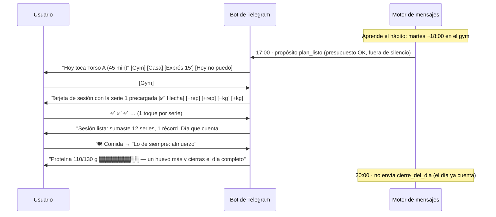
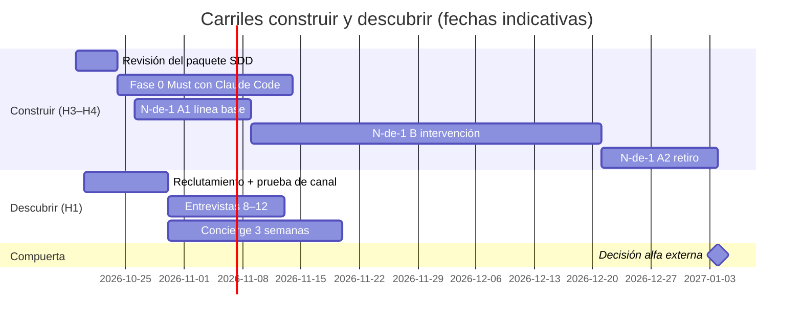

# Propuesta de valor — *Gym Bro* · v0.2

> [!note] Qué cambió en esta versión
> Incorpora las 22 observaciones del PO del 2026-10-18 ([[FB-001_2026-10-18_observaciones-po|FB-001]]) y su corrección posterior: **en la Fase 0/01 el producto es un bot de Telegram estructurado**, no una app móvil, no un chatbot conversacional y no un personaje compañero. La versión anterior queda en [[propuesta-de-valor-v0-1]]. Las reglas que se derivan de este documento viven en [[reglas-de-negocio]]; las especificaciones, en [[spec-000-vision-fase-0]].

---

## 0. Trazabilidad de las observaciones (FB-001 → cambios)

| ID | Observación | Cambio aplicado | Dónde |
|---|---|---|---|
| FB-001-01 | Edad máxima 32 | Segmento 18–32 años | §4 · [[usuario-cabeza-01]] · ADR-008 |
| FB-001-02 | Usar gamificación | Sistema de gamificación individual con mecánicas de Duolingo adaptadas | §11 · [[sistema-de-gamificacion]] · [[spec-005-dia-que-cuenta-y-gamificacion]] |
| FB-001-03 | Cómo evitar el riesgo de novedad | Estrategia de 10 palancas, alertas tempranas e índice de sostenimiento | §17 · [[estrategia-anti-novedad]] |
| FB-001-04 | Comida y ejercicio como relación | "Día que cuenta" con dos mitades; la comida depende del tipo de día | §9.3 · [[relacion-comida-entreno]] |
| FB-001-05 | Conectar con otras apps; más allá del chatbot | Imágenes de progreso, Mini App dentro de Telegram, integraciones nube a nube y puente de ingesta | §9.5 · [[integraciones-y-ecosistema]] · ADR-013 · ADR-014 |
| FB-001-06 | Fragmentado y medible | 9 módulos, cada uno con reglas, parámetros, eventos y métrica propios | §9.2 · [[plan-de-medicion]] |
| FB-001-07 | Visualizar el esfuerzo; cada día cuenta | Contador acumulado que nunca baja, muro de constancia, Reto 66 | §10 · [[cada-dia-cuenta]] |
| FB-001-08 | La fricción de registro es la causa más fuerte | Pasa a causa raíz n.º 1; principio "confirmar, no escribir"; presupuestos de toques | §3 · [[registro-sin-friccion]] |
| FB-001-09 | Usuario poco sociable; lo social no es el centro | Segmento "entrena solo"; sin rankings entre usuarios; "tu rival eres tú" | §4 · ADR-009 |
| FB-001-10 | ¿Qué pasa tras cumplir el objetivo? | Modo mantenimiento como objetivo de primera clase | §10.4 · [[objetivos-y-progreso]] · ADR-018 |
| FB-001-11 | No es un bot de IA; no crear un compañero | Bot estructurado (botones y comandos), sin personaje ni charla libre; IA acotada a tareas de percepción | §7.4 · §9.6 · ADR-006 · ADR-007 |
| Corrección 18:24 | "Por ahora no es una app móvil, es un chatbot en Telegram" | Canal de la Fase 0/01: Telegram | ADR-002 (aceptado) |
| FB-001-12 | Hombres; mujeres no en Fase 01 | Segmento masculino en Fase 01; el modelo de datos no bloquea la expansión | §4 · ADR-008 |
| FB-001-13 | Felicitar el ejercicio en casa; lo clave es la constancia | Toda sesión tiene versión gym, casa y exprés; las tres cuentan igual | §9.4 · [[constancia-en-cualquier-lugar]] |
| FB-001-14 | Revisar a fondo el usuario cabeza 01 | Proto-persona con comportamiento, barreras y filtro de reclutamiento | §4 · [[usuario-cabeza-01]] |
| FB-001-15 a 18 | JTBD 01–04 | JTBD reescritos y mapa del trabajo | §5 · [[jobs-to-be-done]] |
| FB-001-19 | Lema de "mejor amigo" | Voz de marca "mejor amigo" y lemas candidatos | §15 · [[voz-y-marca]] |
| FB-001-20 | ¿Cuál es el objetivo del usuario? | Catálogo de 6 objetivos medibles | §10 · [[objetivos-y-progreso]] |
| FB-001-21 | El progreso debe tener un objetivo | Tres capas de medición y fórmula de progreso | §10 · [[objetivos-y-progreso]] |
| FB-001-22 | Conocer el hábito de gym; escribir primero sin ser spam | Hábito declarado y aprendido; presupuesto de mensajes; retroceso y desvanecimiento | §9.1 · [[proactividad-sin-spam]] · ADR-011 |

**Qué se eliminó de v0.1:** el personaje/avatar con personalidad, la conversación libre, la categoría "compañero de entrenamiento con IA", la prueba de preferencia de personaje (antigua H03) y el Mago de Oz en el que el fundador "actuaba" de personaje (se reemplaza por un *concierge* de servicio, §16).

---

## 1. Resumen ejecutivo

**Qué es.** Gym Bro es un **bot de Telegram que hace que cada día cuente**. Arma tu plan según tu nivel, tu tiempo y tu objetivo; te lo tiene listo antes de la hora en que sueles entrenar; te deja registrar el entreno y la comida con botones, casi sin escribir; y te muestra el esfuerzo que vas acumulando —en el gym, en casa o en versión exprés— para que la constancia deje de depender de la motivación.

**Qué no es.** No es un chatbot para conversar, no es un personaje ni un compañero virtual, no es una red social, no es una herramienta médica y no es un contador de calorías.

**Para quién.** Hombres de 18 a 32 años que entrenan solos —o quieren hacerlo—, que han empezado y abandonado al menos una vez, y que no quieren depender de un parche de gym para motivarse ([[usuario-cabeza-01]]). Mercado inicial supuesto: Colombia (ADR-016).

**El problema, en el orden del PO.** (1) Registrar cuesta y es la causa más fuerte de abandono; (2) el esfuerzo es inmediato y la recompensa tarda semanas; (3) quien entrena solo no tiene quién note su esfuerzo; (4) un día fallado se siente como empezar de cero; (5) las herramientas esperan a que el usuario las abra y separan comida de entreno.

**Diferenciación.** La categoría ya ofrece planes con IA y registro por foto (`F27`, `F29`, `F30`). Gym Bro compite en otra cosa:
1. **Se anticipa sin abrumar:** escribe primero, en el momento del hábito, con un presupuesto de mensajes que se reduce si el usuario no responde.
2. **Registro casi sin escribir:** confirmar una serie es 1 toque; registrar una comida frecuente, 1 toque; por porciones, menos de 20 segundos.
3. **Cada día cuenta:** el gym, la casa, la sesión exprés y hasta el día de descanso (si comes bien) suman a un contador que nunca baja.
4. **No castiga:** comodines, regreso premiado, sin deudas de entrenamiento ni lenguaje de fracaso.
5. **Del progreso al mantenimiento:** cuando el usuario cumple su objetivo, el producto cambia de modo en lugar de quedarse sin propósito.

**Cómo se valida.** Dos carriles en paralelo: **construir** la Fase 0 para uso propio con un protocolo N-de-1, y **descubrir** con 8–12 entrevistas, un *concierge* de 3 semanas y una prueba de adopción del canal Telegram (§16, §18).

**Riesgos más críticos.** (a) Que el uso no se sostenga más allá de la novedad: la gamificación pierde efecto con el tiempo (`F25`), las sugerencias proactivas generan habituación (`F49`) y solo el 8 % de 54 intervenciones para ir al gym dejó efecto medible al terminar (`F46`). (b) Que el canal limite el mercado: no hay datos confiables recientes de uso de Telegram en Colombia, donde WhatsApp domina (`F75`, `F76`).

**Recomendación.** Aprobar esta versión, iniciar H4 con Claude Code (Fase 0, uso propio) a partir del paquete [[spec-000-vision-fase-0]] y correr H1 en paralelo. Ninguna alfa con usuarios externos antes de pasar la compuerta de §12.4.

---

## 2. Contexto

La iniciativa nace de una necesidad del fundador: tener un "parcero de gym" que sepa qué toca hoy, recuerde lo que llevas y te empuje sin juzgarte. Los referentes son **Duolingo** por sus mecánicas de constancia —50,5 M de usuarios diarios en 3T 2025 (`F10`)— y **Fitia** por su nutrición con IA para el público hispanohablante, con más de 10 M de usuarios (`F08`).

La revisión del PO precisó tres cosas que cambian el diseño: el usuario objetivo **entrena solo**; el producto **no es un compañero virtual sino un sistema que se anticipa**; y **la constancia importa más que el lugar** donde se entrena.

---

## 3. Definición del problema

### 3.1 Planteamiento

> Los hombres jóvenes que entrenan solos saben que deben ser constantes, pero abandonan porque registrar cuesta, los resultados tardan semanas en verse, nadie nota su esfuerzo y cualquier falla se siente como volver a cero. Las herramientas disponibles esperan a que las abran, separan la comida del entreno y miden el éxito por resultados que todavía no llegan.

### 3.2 Causas raíz (priorizadas)

| # | Causa | Evidencia o fundamento | Respuesta de diseño |
|---|---|---|---|
| 1 | **Fricción de registro** — la más fuerte según el PO | Incluso en Cal AI, solo ~30 % de las calorías registradas provienen de la foto (`F31`); el registro por foto subestimó energía y grasa en ~1/3 (`F18`). | [[registro-sin-friccion]]: confirmar en vez de escribir; comidas frecuentes; porciones con la mano. |
| 2 | **Recompensa diferida** | La automaticidad de un hábito tomó una mediana de 66 días, con un rango de 18 a 254 (`F45`). | [[cada-dia-cuenta]]: medir y celebrar lo que se controla hoy. |
| 3 | **Entrenar solo, sin rendición de cuentas** | Observación del PO (FB-001-09). `[hipótesis H09]` | El sistema escribe primero y lleva la cuenta; sin presión social. |
| 4 | **Mentalidad de todo o nada** | Fallar un día no alteró de forma relevante la formación del hábito (`F45`); premiar el regreso tras faltar fue la mejor de 54 intervenciones para aumentar visitas al gym (`F46`). | Comodines, reparar racha, bonificación de regreso, sin deudas. |
| 5 | **Herramientas reactivas y fragmentadas** | Los líderes son especialistas por dominio ([[benchmark-competitivo]]). | Un solo día con dos mitades: entreno y comida. |
| 6 | **Plan que no encaja** con nivel, tiempo u objetivo | JTBD-01 del PO (FB-001-15). | Plan generado por reglas con versiones A/B/C. |

### 3.3 Evidencia de contexto

| Síntoma | Dato | Fuente |
|---|---|---|
| La inactividad crece | Actividad física insuficiente en adultos: 31,3 % mundial (2022); América Latina y el Caribe tuvo la prevalencia regional más alta en 2016 (39,1 %) | `F37`, `F38` |
| Las apps no retienen | Retención D30 de Salud y Fitness ≈ 3–5 % | `F43` (C) |
| Los que pagan renuevan poco | La categoría tiene la retención en primera renovación más baja (30,3 %) | `F14` |
| Las intervenciones decaen | Solo 8 % de 54 programas dejó efecto medible al terminar | `F46` |

---

## 4. Segmento: usuario cabeza 01

Detalle completo, filtro de reclutamiento y supuestos en [[usuario-cabeza-01]].

| Atributo | Definición (Fase 01) |
|---|---|
| Quién | Hombre de 18 a 32 años, en Colombia (supuesto, ADR-016) |
| Situación | Entrena solo o quiere empezar; ha iniciado y abandonado al menos una vez |
| Rasgo distintivo | Poco sociable en el gym: no pide ayuda, entrena con audífonos, no quiere depender de un parche |
| Objetivo típico | Ganar músculo o "ponerse en forma"; a veces bajar grasa |
| Restricciones | Tiempo irregular (estudio o trabajo), presupuesto limitado, comida de casa o almuerzo corrientazo |
| Tecnología | Smartphone (Android en ~78,5 % de los móviles en Colombia, `F64`); usa Telegram o está dispuesto a instalarlo `[hipótesis H10]` |
| Fuera de alcance en Fase 01 | Mujeres (fase futura); menores de 18; atletas de competencia; quien busca entrenar en comunidad; condiciones médicas que requieren supervisión (se derivan) |

**Tamaño estimado en Colombia** (orden de magnitud, a validar):

| Paso | Valor | Fuente |
|---|---|---|
| Hombres de 18 a 32 años (2026) | ≈ 6,66 M | `F65` (prorrateo de grupos quinquenales) |
| Personas que van al gym en Colombia | > 2 M | `F66` (estimación de la industria, 2024) |
| Hombres de 18 a 32 que van al gym | ≈ 0,5–1,0 M | `[supuesto]`: 25–35 % de los usuarios de gym, o 10–15 % de penetración en el grupo |
| … que entrenan solos y ya abandonaron antes | ≈ 0,25–0,7 M | `[supuesto 50–70 %, validar en H1]` |
| … que usan Telegram | **desconocido** | No hay dato confiable reciente; la única encuesta pública hallada (2017) ubicaba a Telegram como app principal de solo 1 % (`F76`, C). `[hipótesis H10]` |

**Lectura:** el segmento es suficientemente grande para validar, pero **el canal puede reducirlo de forma drástica**. Por eso la arquitectura separa el núcleo del canal (ADR-002, ADR-015) y H10 se prueba desde H1.

---

## 5. *Jobs to be Done*

Detalle y mapa del trabajo en [[jobs-to-be-done]].

**Trabajo principal:** *Volverme constante en el gym —sin depender de la motivación ni de nadie— para lograr el cuerpo y la energía que quiero, y mantenerlos.*

| ID | Tipo | Cuando… quiero… para… | Origen |
|---|---|---|---|
| JTBD-01 | Funcional | Cuando voy a entrenar, quiero un plan hecho para **mi nivel, mi tiempo y mi objetivo**, para no perder tiempo pensando y saber que voy bien. | FB-001-15 |
| JTBD-02 | Funcional | Cuando como, quiero registrarlo **fácil y con comida accesible** —la que de verdad como y puedo pagar—, para saber si como para mi objetivo sin volverme contador. | FB-001-16 |
| JTBD-03 | Emocional | Cuando no progreso o fallo un día, quiero que **nada me castigue** y que me muestren cómo seguir, para no rendirme como otras veces. | FB-001-17 |
| JTBD-04 | Identidad | Cuando logro algo, quiero **guardarlo y volver a verlo**, para recordar que sí es posible. | FB-001-18 |
| JTBD-05 | Funcional | Cuando no puedo ir al gym, quiero una alternativa en casa que **también cuente**, para no romper la constancia. | FB-001-13 |
| JTBD-06 | Emocional | Cuando entreno solo, quiero que **alguien lleve la cuenta** de mi esfuerzo sin tener que socializar, para motivarme a mi manera. | FB-001-09 |
| JTBD-07 | Funcional | Cuando ya alcancé mi objetivo, quiero un plan para **mantenerlo** con menos esfuerzo, para no perder lo ganado. | FB-001-10 |

---

## 6. *Value Proposition Canvas* (usuario cabeza 01)

| Trabajos | Dolores | Alegrías esperadas |
|---|---|---|
| Entrenar con un plan claro | "No sé qué hacer hoy ni cuánto peso usar" | Llegar al gym con la sesión lista |
| Comer para su objetivo | Registrar es tedioso; comer "fit" sale caro | Registrar en segundos con lo que ya come |
| Ver progreso | Los resultados tardan y desmotivan | Ver cada día sumar |
| Ser constante | Nadie nota cuando falta; un mal día lo tumba | Volver sin culpa y sin empezar de cero |
| Recordar logros | Olvida cuánto ha avanzado | Una bitácora que demuestra que sí es posible |
| Mantener lo logrado | Tras la meta, pierde el norte | Un modo que sostiene sin exigir más |

| Productos y servicios | Aliviadores | Creadores de alegría |
|---|---|---|
| Plan semanal con versiones gym / casa / exprés | Mensaje "plan listo" antes de su hora habitual | Récords personales detectados y celebrados |
| Tarjeta de sesión con botones | Confirmar una serie con 1 toque | Resumen "lo que sumaste hoy" |
| Registro por porciones con la mano y comidas frecuentes | Sin pesar ni buscar alimentos | Proteína del día con barra de avance |
| Día que cuenta, racha, comodines, XP y niveles | Comodines y reparar racha | Contador acumulado que nunca baja; Reto 66 |
| Resumen semanal con muro de constancia | Ajuste del plan sin deuda | Liga contra tu propia semana anterior |
| Modo mantenimiento | Compromiso mínimo realista | Temporadas de habilidades |

**Ajuste más fuerte:** "registrar es tedioso" ↔ confirmar con 1 toque, porque ataca la causa n.º 1. **Ajuste más débil (validar primero):** que un mensaje proactivo con presupuesto supere la habituación sin que el usuario silencie el bot (H03, H08).

---

## 7. Propuesta de valor y posicionamiento

### 7.1 Declaración de propuesta de valor

> **Gym Bro hace que cada día cuente:** te escribe primero con tu plan listo —para el gym, la casa o en versión exprés—, registra tu entreno y tu comida con un toque y te muestra el esfuerzo que vas sumando, para que ser constante deje de depender de la motivación.

### 7.2 Declaración de posicionamiento

> Para hombres de 18 a 32 años que entrenan solos y han abandonado más de una vez, **Gym Bro** es un **sistema de constancia dentro de Telegram** que une entreno y comida en un solo día que cuenta. A diferencia de los registradores (Hevy, Fitbod, Fitia), que esperan a que los abras y miden un solo frente, y de los asistentes generales (ChatGPT, Gemini), que responden pero no llevan la cuenta, Gym Bro **se anticipa sin abrumar, registra casi sin escribir y nunca te castiga por fallar**.

### 7.3 Pilares de diferenciación

| # | Pilar | Argumento | Evidencia |
|---|---|---|---|
| P1 | **Se anticipa sin abrumar** | Valor más fuerte según el PO (FB-001-22). Atar la acción a un cuándo y un dónde funciona: los planes "si–entonces" tuvieron un efecto medio de d = 0,65 en 94 pruebas. A la vez, Duolingo trata el canal de notificaciones como un activo que no se arriesga, porque una baja suele ser permanente. | `F47`, `F51` |
| P2 | **Registro casi sin escribir** | Causa raíz n.º 1 (FB-001-08). | `F31` |
| P3 | **Cada día cuenta** | El esfuerzo debe verse antes que el resultado; un día fallado no deshace el hábito. | `F45` |
| P4 | **Comida y entreno, un solo día** | La proteína diaria total es el puente entre comer y crecer: hasta ~1,6 g/kg/día suma ganancias de masa libre de grasa. | `F56`, `F57` |
| P5 | **Constancia en cualquier lugar** | Con cargas bajas también hay ganancias sustanciales en no entrenados; con una sesión semanal de alta intensidad se mantiene la fuerza hasta 32 semanas. | `F53`, `F52` |
| P6 | **No castiga** | Premiar el regreso tras faltar fue la intervención más efectiva para ir al gym. | `F46` |

**Habilitador (paridad):** comidas y lenguaje colombianos; Fitia ya es fuerte en alimentos latinoamericanos (`F09`).

### 7.4 Qué *no* es Gym Bro

- **No es un bot de IA conversacional.** No sostiene charlas libres: responde con botones y flujos. El texto libre solo se usa para registrar comida o pedir algo del dominio (ADR-006).
- **No es un compañero virtual ni un personaje.** No tiene sentimientos, no "se pone triste" y no simula amistad; la voz de "mejor amigo" es el tono de los mensajes ([[voz-y-marca]]).
- **No es una red social.** Sin rankings entre usuarios ni feed (ADR-009).
- **No es una herramienta médica** (ADR-004).
- **No es un contador de calorías.** Las calorías están apagadas por defecto (ADR-012).

### 7.5 ¿Por qué ahora?

1. El mercado acepta pagar por orientación digital de fitness: Google cobra USD 9,99/mes por su coach (`F27`) y MyFitnessPal compró Cal AI tras 15 M de descargas (`F30`).
2. La fricción y la novedad siguen sin resolverse: la categoría convierte bien pero renueva mal (`F14`, `F15`).
3. Telegram permite mensajes proactivos sin costo por mensaje y una Mini App dentro del mismo chat (`F69`), lo que reduce el costo de validar. `[inferencia]`
4. En Colombia hay más de 2 M de usuarios de gimnasio (`F66`) y la mayor cadena supera las 236 sedes en el país (`F67`).

---

## 8. Síntesis competitiva

Detalle en [[benchmark-competitivo]].

| Dimensión | Posición de Gym Bro | Justificación |
|---|---|---|
| Plan personalizado, registro por foto | **Paridad** | Ya lo ofrecen Fitia, MyFitnessPal/Cal AI, Google y Fitbod. |
| Proactividad con presupuesto y desvanecimiento | **Diferenciación** | Nadie en el benchmark lo hace explícito como regla de producto. |
| Registro por confirmación y porciones con la mano | **Diferenciación** | Ataca la fricción en lugar de la precisión. |
| Entreno y comida en un solo "día que cuenta" | **Diferenciación** | Los líderes son especialistas por dominio. |
| Casa, exprés y mantenimiento como ciudadanos de primera | **Diferenciación** | El foco del mercado está en el gym y en el progreso. |
| Precisión calórica | **No competir** | Prometer precisión es una posición vulnerable (`F18`). |

---

## 9. Concepto de producto

### 9.1 Un día con Gym Bro (Fase 0)

### 9.2 Módulos (fragmentado y medible)

| Módulo | Responsabilidad | Spec | Reglas | Métrica clave |
|---|---|---|---|---|
| Onboarding y objetivo | Consentimiento, tamizaje, objetivo medible, hábito | [[spec-001-onboarding-y-objetivo]] | RN-OBJ, RN-SEG, RN-DAT | % que termina el onboarding en ≤ 3 min |
| Plan | Plan semanal y sesión del día (A/B/C) | [[spec-002-plan-y-sesion-del-dia]] | RN-PLAN | % de sesiones iniciadas desde "plan listo" |
| Entrenamiento | Tarjeta de sesión, progresión, récords | [[spec-003-registro-de-entrenamiento]] | RN-ENT | Toques por serie |
| Nutrición | Porciones, frecuentes, foto, proteína | [[spec-004-registro-de-nutricion]] | RN-NUT | Segundos por comida |
| Día que cuenta y juego | DQC, racha, comodines, XP, niveles, misiones | [[spec-005-dia-que-cuenta-y-gamificacion]] | RN-DQC, RN-GAM | DQC por semana |
| Progreso y mantenimiento | Resumen semanal, muro, bitácora, objetivo, mantenimiento | [[spec-006-progreso-logros-y-mantenimiento]] | RN-OBJ, RN-MAN | Semanas cumplidas |
| Mensajes proactivos | Única puerta de salida de mensajes no solicitados | [[spec-007-proactividad-y-mensajes]] | RN-MSJ | Tasa de acción y tasa de bloqueo |
| Integraciones | Exportar, puente de ingesta, fuentes externas | [[spec-008-integraciones]] | RN-INT | % de días con datos pasivos |
| Seguridad y datos | Límites, derivación, privacidad | [[spec-009-seguridad-y-privacidad]] | RN-SEG, RN-DAT | Fallos críticos = 0 |

### 9.3 Día que cuenta (resumen)

Cada día tiene dos mitades: **entreno** y **comida**. Un día **cuenta** si se cumple la mitad que corresponde al tipo de día; es **completo** si se cumplen ambas. Detalle en [[cada-dia-cuenta]] y [[relacion-comida-entreno]].

| Tipo de día | Cuenta si… | Es completo si… |
|---|---|---|
| Entreno | Completas una sesión (gym, casa o exprés) o se importa una actividad válida | Además, cumples tu proteína (≥ 80 % de la meta) |
| Descanso | Cumples la misión de descanso: proteína **o** recuperación activa (pasos o movilidad) | Cumples ambas |

### 9.4 Constancia en cualquier lugar

Cada sesión planificada tiene tres versiones equivalentes: **A (gym)**, **B (casa** con lo que tengas) y **C (exprés,** 15–20 min en cualquier lugar). Las tres cuentan para el día y se celebran igual. Detalle en [[constancia-en-cualquier-lugar]].

### 9.5 Más allá del chat, sin salir de Telegram

| Capa | Qué aporta | Fase |
|---|---|---|
| Mensajes con botones | Registro y decisiones en 1 toque | 0 (Must) |
| Imágenes generadas por el servidor | Muro de constancia, resumen semanal, logro desbloqueado | 0 (Must: resumen semanal; Should: resto) |
| **Mini App** dentro de Telegram | Progreso interactivo, bitácora, objetivo; háptica y pantalla completa (`F69`) | 0 (Should) / 1 |
| Exportación de datos | CSV/JSON para análisis y portabilidad | 0 (Must) |
| Puente de ingesta (*webhook*) | Pasos y actividades desde Atajos de iOS o automatizaciones de Android | 0 (Could) / 1 |
| Fuentes nube a nube | Hevy, Strava, Google Calendar | 1 |
| App nativa | Lectura directa de Health Connect / Apple Health | 2+ (solo si se valida la necesidad) |

Por qué no se conecta directo a los datos de salud del teléfono: Health Connect y Apple Health son accesibles desde apps instaladas en el dispositivo, no desde un bot en un servidor; la API de Google Fit cerró en 2025 (`F62`) y la API web de Fitbit cierra el 30-oct-2026 con incorporación de proyectos nuevos en pausa (`F63`, C). Ver [[integraciones-y-ecosistema]].

### 9.6 Rol de la IA (acotada)

La IA **percibe; el dominio decide** (ADR-007):
- **Sí:** convertir una foto o un texto de comida en una **propuesta de porciones** que el usuario confirma.
- **No:** conversar, motivar con texto generado, recomendar dietas o rutinas, ni responder preguntas de salud. Los planes, la progresión, los límites y los mensajes salen de reglas y plantillas revisadas.

### 9.7 Bucles

| Bucle | Secuencia |
|---|---|
| Diario | Plan listo → sesión (A/B/C) o misión de descanso → registro con toques → "día que cuenta #N" |
| Semanal | Resumen con muro → semana cumplida o no → misiones nuevas → plan de la semana |
| De regreso | Día fallado → comodín automático o misión de regreso (48 h) → bonificación de regreso |
| De temporada | Cada 6 semanas: tema, meta y cierre con insignia (nuevo comienzo en lunes, `F48`) |
| De objetivo | Progreso → objetivo cumplido → mantenimiento o nueva fase |

---

## 10. Objetivo del usuario y medición del progreso

Detalle, fórmulas y límites en [[objetivos-y-progreso]].

### 10.1 Catálogo de objetivos

| Objetivo | Métrica principal | Meta típica (12 semanas) | Límite de seguridad |
|---|---|---|---|
| Ganar músculo | Peso (media de 7 días) + fuerza en ejercicios clave | +0,25 a 0,5 % del peso por semana | Ganancia ≤ 0,5 %/semana (`F59`) `[VALIDAR-PROFESIONAL]` |
| Perder grasa | Peso (media de 7 días) + cintura | −0,5 a −1 % del peso por semana | Pérdida ≤ 1 %/semana (`F58`); IMC meta ≥ 18,5 `[VALIDAR-PROFESIONAL]` |
| Ganar fuerza | 1RM estimado en 1–3 ejercicios | +X % de e1RM | Progresión doble conservadora |
| Recomposición | Fuerza + cintura con peso estable | Cintura ↓ con e1RM ↑ | Igual que los anteriores |
| Ser constante | Semanas cumplidas | 10 de 12 semanas | — |
| Mantener | Banda de peso ± 2 % y compromiso mínimo | 2+ sesiones/semana | Ver §10.4 |

### 10.2 Tres capas de medición

> **Medimos lo que controlas cada día; celebramos lo que cambia cada mes.**

| Capa | Frecuencia | Indicadores | Uso |
|---|---|---|---|
| Proceso | Diaria | Días que cuentan, sesiones, proteína | Reconocimiento inmediato (lo que el usuario controla) |
| Rendimiento | Semanal | 1RM estimado, repeticiones, volumen | Récords y progresión |
| Resultado | Cada 2–4 semanas | Peso (media de 7 días), cintura | Progreso del objetivo |

**Progreso del objetivo** = (valor actual − inicial) / (meta − inicial), acotado entre 0 y 100 %.

### 10.3 Recorrido

**Reto 66** (los primeros 66 días que cuentan; mediana de automaticidad en `F45`) → **Progreso** (fases de 4–24 semanas) → **Mantenimiento**. El Reto 66 cuenta días acumulados, no consecutivos: fallar un día no lo reinicia.

### 10.4 Modo mantenimiento (FB-001-10)

Cuando el usuario cumple su objetivo, el sistema celebra, guarda el logro en la bitácora y ofrece **mantener** o **abrir una nueva fase**. En mantenimiento: compromiso mínimo de 2 sesiones de fuerza por semana (la fuerza y el tamaño muscular se mantuvieron hasta 32 semanas con 1 sesión semanal si la intensidad se conserva, `F52`; la OMS recomienda fortalecimiento muscular 2 o más días por semana, `F39`), proteína igual, banda de peso ± 2 %, mensajes al mínimo y gamificación de **maestría** (habilidades y récords de repeticiones).

---

## 11. Gamificación (resumen)

Diseño completo en [[sistema-de-gamificacion]]; evidencia en [[gamificacion-y-habitos]].

| Mecánica de Duolingo | Adaptación en Gym Bro | Por qué |
|---|---|---|
| Racha diaria | Racha de **días que cuentan** (descanso incluido) | La racha fue el primer gran motor de retención de Duolingo (`F51`) |
| *Streak freeze* | **Comodín** (1 cada 7 días; máx. 2) y **reparar racha** en 48 h | Fallar un día no deshace el hábito (`F45`) |
| XP y niveles | **Puntos de esfuerzo** y 10 niveles con nombre de identidad | Progreso visible inmediato |
| Ligas | **Liga contra ti mismo**: tu semana vs. tu semana anterior y tu mejor semana | El segmento no es social (FB-001-09) |
| Misiones | 3 **misiones semanales** adaptadas a tu historial | Renovación contra la habituación (`F49`) |
| Eventos | **Temporadas** de 6 semanas que empiezan en lunes | Efecto de nuevo comienzo (`F48`) |
| Logros | **Bitácora** de logros con fecha y dato | JTBD-04 |
| — | **Bonificación de regreso** | Mejor intervención del megaestudio (`F46`) |

**Prohibido:** perder XP, rankings entre usuarios, premiar el déficit calórico o la pérdida de peso, mensajes de culpa y cualquier personaje que "sufra".

---

## 12. Alcance de la Fase 0 y compuerta

Especificación completa en [[spec-000-vision-fase-0]].

### 12.1 MoSCoW

| Prioridad | Funcionalidad |
|---|---|
| **Must** | Onboarding con consentimiento, tamizaje, objetivo y hábito · Plan semanal y sesión del día A/B/C · Tarjeta de sesión con botones · Registro de comida por porciones y frecuentes · Proteína del día · Día que cuenta, racha, comodines, XP y niveles · Motor de mensajes proactivos con presupuesto, silencio, retroceso y pausa · Resumen semanal con imagen del muro · Bitácora de logros · Exportar datos · Borrar datos · Respuestas de seguridad predefinidas |
| **Should** | Foto de comida → propuesta de porciones · Récords personales · Reparar racha · Misiones semanales · Modo mantenimiento · Mini App de progreso |
| **Could** | Texto libre de comida → porciones · Puente de ingesta de pasos · Temporadas · Liga personal |
| **Won't (Fase 0)** | Pagos · App nativa · Rankings sociales · Calorías · Fotos de progreso corporal · Integraciones OAuth |

### 12.2 Canal

**Telegram** (ADR-002, aceptado por el PO): costo cero por mensaje, botones, fotos, comandos, Mini Apps y mensajes iniciados por el bot después de `/start`. La política de Meta que desde el 15-ene-2026 prohíbe asistentes de IA de propósito general en la API de WhatsApp Business (`F41`) refuerza la elección para validar.

### 12.3 Protocolo N-de-1 (uso propio)

| Fase | Duración | Condición | Mide |
|---|---|---|---|
| A1 · Línea base | 2 semanas | Método actual, registro en hoja de cálculo | Sesiones completadas/planificadas; días con proteína registrada; motivación (1–7) |
| B · Intervención | 6 semanas | Gym Bro | Lo anterior + toques y segundos por registro, tasa de acción de mensajes, comodines usados, costo de IA por día activo |
| A2 · Retiro | 2 semanas | Sin Gym Bro | Persistencia del hábito |

Complemento: 20 comidas pesadas (H14) y *red-team* de 50+ escenarios (H11).

### 12.4 Compuerta hacia la alfa externa (umbrales provisionales)

1. Sesiones completadas en B ≥ 20 % por encima de A1.
2. Mediana de 1 toque por serie confirmada y ≤ 20 s por comida (porciones o frecuente).
3. ≥ 70 % de comidas con proteína estimada dentro de ±25 % de la referencia (H14).
4. Cero fallos críticos en el *red-team*.
5. Ningún día con más mensajes proactivos que el presupuesto (verificado en registros).
6. Costo de IA por día activo medido (insumo de H13).
7. Resultados de H1 que no refuten H01, H09 y H10.

---

## 13. Modelo de negocio (hipótesis)

| Bloque | Contenido |
|---|---|
| Segmento | Usuario cabeza 01 |
| Propuesta única | Constancia sin fricción: se anticipa, registra con un toque y no castiga |
| Canales (hipótesis) | Contenido corto con historias de constancia; gimnasios independientes; referidos |
| Ingresos | *Freemium*; plan anual como producto principal (en Salud y Fitness, los anuales concentran el 60,6 % de los ingresos, `F14`) |
| Restricción del canal | En Telegram, los bienes y servicios digitales deben cobrarse en **Telegram Stars**; los bots deben responder `/paysupport` y gestionar reembolsos (`F70`) |
| Costos | IA (solo percepción), servidor, base de datos, asesoría profesional y legal |
| Ventaja difícil de copiar | Datos de hábito del usuario + reglas de proactividad afinadas + contenido local `[a construir]` |

**Hipótesis de precio (Fase 1):** banda equivalente a USD 24,99–44,99 al año, entre Hevy (USD 23,99) y Google Health Premium (USD 99) (`F27`, `F33`), ajustada a Colombia y convertida a Stars `[supuesto — validar con Van Westendorp y la tabla vigente de Stars]`.

---

## 14. Métricas

**Estrella del Norte (M00): semanas cumplidas por usuario activo en las últimas 4 semanas** (ADR-005). Unidad diaria de valor: **día que cuenta** (ADR-010).

| ID | Métrica | Definición breve |
|---|---|---|
| M01 | Días que cuentan por usuario activo por semana | 0–7 |
| M02 | Retención D1/D7/D30 e **índice de sostenimiento** | DQC promedio de las semanas 5–8 ÷ semanas 1–4 (meta ≥ 0,8) |
| M03 | Tasa de acción de mensajes proactivos | Acción en ≤ 2 h / mensajes enviados |
| M04 | Toques por serie y segundos por comida | Mediana |
| M05 | % de días con mitad de comida cumplida | — |
| M06 | % de días que cuentan desde casa o exprés | Mide FB-001-13 |
| M07 | Tasa de regreso ≤ 48 h tras un día fallado | Mide "no castigar" |
| M08 | Conversión prueba → pago (Fase 1) | Referencia de categoría: 35 % (`F14`) |

| ID | Salvaguarda | Umbral |
|---|---|---|
| G01 | Fallos críticos de seguridad | 0 |
| G02 | Objetivos fuera de los límites de seguridad | 0 |
| G03 | Tasa de bloqueo del bot | Vigilar; alerta > 5 % mensual `[supuesto]` |
| G04 | Uso de `/pausa` | Vigilar: indica exceso de mensajes |
| G05 | Días con entreno en todos los descansos (2+ semanas) | Vigilar: posible sobreuso |

Detalle de eventos y fórmulas en [[plan-de-medicion]].

---

## 15. Marca y voz

Detalle en [[voz-y-marca]].

- **Voz: el mejor amigo de los que entrenan solos.** Está pendiente, escribe primero, recuerda tus logros, celebra en serio y nunca te juzga. Es tono, no personaje.
- **Lema recomendado para probar:** **"Entrenas solo. No estás solo."** Alternativas: "Cada día cuenta.", "El parcero que siempre está pendiente.", "Tu mejor amigo para no fallarte."
- **Nombre de trabajo:** *Gym Bro*. Con el foco masculino de la Fase 01, la objeción de v0.1 sobre exclusión pierde peso; sigue pendiente la búsqueda de marca y de usuario disponible en Telegram (Q7).

---

## 16. Hipótesis y validación

| ID | Hipótesis | Experimento | Criterio provisional | Hito |
|---|---|---|---|---|
| H01 | El abandono se explica más por fricción y falta de constancia que por falta de información | 8–12 entrevistas + encuesta | ≥ 60 % menciona registro tedioso o constancia como causa principal | H1 |
| H02 | El "plan listo" proactivo aumenta las sesiones completadas | N-de-1 A-B-A | +20 % vs. línea base | H4 |
| H03 | Con el presupuesto definido, el bot no se silencia ni se bloquea | N-de-1 + concierge | Bloqueos = 0 en concierge; tasa de acción ≥ 40 % | H1–H4 |
| H04 | Registrar sin fricción es sostenible | N-de-1 | 1 toque por serie; ≤ 20 s por comida | H4 |
| H05 | Ver el esfuerzo acumulado sostiene la constancia de las semanas 3–8 | Concierge (muro en imagen) + alfa | Índice de sostenimiento ≥ 0,8 | H1–Alfa |
| H06 | Las versiones casa/exprés evitan romper la constancia | N-de-1 + alfa | ≥ 30 % de los DQC en semanas con imprevistos vienen de B/C | H4–Alfa |
| H07 | Cumplir la proteína se asocia con más constancia de entreno | Alfa (correlación observada) | Asociación positiva | Alfa |
| H08 | El uso se sostiene más allá de la novedad | Alfa (5–15 usuarios, 8 semanas) | ≥ 40 % activos en la semana 8 | Alfa |
| H09 | El segmento prefiere motivación sin componente social | Entrevistas | ≥ 60 % prefiere no social | H1 |
| H10 | El usuario cabeza 01 usa Telegram o lo instala sin fricción | Prueba de canal en el reclutamiento | ≥ 60 % ya lo usa o lo instala en el momento | H1 |
| H11 | El sistema rechaza o deriva el 100 % de los escenarios de riesgo | *Red-team* ≥ 50 escenarios | 0 fallos críticos | H4 |
| H12 | Existe un precio aceptable en la banda propuesta | Van Westendorp + *fake door* | Rango identificado | Alfa |
| H13 | El costo de IA por usuario activo es ≤ 25 % del ingreso medio por usuario de pago | Medición en Fase 0 | Umbral cumplido | H4 |
| H14 | Las porciones (mano o foto) estiman bien la proteína | 20 comidas pesadas | ≥ 70 % dentro de ±25 % | H4 |

**Supuesto más riesgoso:** H08 junto con H03 —que un sistema proactivo, sin personaje y sin componente social, sostenga la constancia más allá de la novedad sin desgastar el canal—. **Prueba más barata antes de programar:** un ***concierge* de 3 semanas** con 5–10 personas del segmento: el fundador envía manualmente por Telegram el plan listo, registra lo que le reportan y les manda cada domingo la imagen del muro de constancia, respetando las reglas de presupuesto de [[proactividad-sin-spam]]. No hay personaje: es un servicio. Si la versión manual no sostiene la constancia en la semana 3, la automatizada tampoco lo hará.

---

## 17. Riesgos

| ID | Riesgo | Prob. | Impacto | Mitigación principal |
|---|---|---|---|---|
| R01 | Consejo dañino: TCA, dismorfia muscular, restricción extrema | Media | Crítico | Tamizaje, modo sin números, respuestas predefinidas, sin calorías por defecto, sin fotos corporales (`F42`, `F60`) |
| R02 | Lesiones | Media | Alto | Progresión conservadora; botón "dolor"; derivación |
| R03 | Porciones imprecisas | Alta | Medio | Ajuste por tendencia; foto solo como propuesta (`F18`) |
| **R04** | **Uso que no se sostiene tras la novedad** | Alta | Alto | [[estrategia-anti-novedad]]: utilidad diaria, hábito anclado, regreso premiado, renovación, desvanecimiento, mantenimiento |
| R05 | Mensajes percibidos como spam → silencio o bloqueo | Media | Alto | Presupuesto, silencio, retroceso, pausa, propósito obligatorio, medición de bloqueos |
| R06 | Baja adopción de Telegram en Colombia | Alta | Alto | H10 desde H1; núcleo independiente del canal |
| R07 | Dependencia de plataforma (reglas de Telegram, pagos en Stars) | Media | Medio | Arquitectura hexagonal; revisar condiciones antes de cobrar (`F70`) |
| R08 | Commoditización (big tech, app de la cadena de gym) | Alta | Alto | Profundidad en constancia y fricción; contenido local |
| R09 | Costo de IA | Baja | Medio | IA solo para percepción; límites por día; medición (H13) |
| R10 | Datos sensibles en chats y servidores | Media | Alto | Aviso de privacidad de Telegram, autorización explícita, minimización (`F40`, `F71`) |
| R11 | Sesgo del fundador | Alta | Medio | Umbrales definidos antes; concierge y alfa externos |
| R12 | Nombre no registrable o usuario de bot ocupado | Media | Medio | Búsqueda temprana (Q7) |
| R13 | Ansiedad por la racha o uso compulsivo | Media | Medio | Comodines, descanso que cuenta, tope de XP, alerta de sobreuso |
| R14 | Integraciones de salud no viables desde un bot | Alta | Medio | Puente de ingesta, fuentes nube a nube, app nativa solo si se valida |

---

## 18. Hoja de ruta (dos carriles)

---

## 19. Preguntas abiertas

| ID | Pregunta | Por qué importa |
|---|---|---|
| Q1 | ¿Confirmas Colombia como mercado inicial? | Ley aplicable, alimentos, precios, lenguaje (ADR-016) |
| Q2 | ¿Cuál es tu línea base personal (objetivo, días, herramientas actuales)? | Protocolo N-de-1 |
| Q3 | ¿Presupuesto mensual y semanas disponibles para la Fase 0? | Hosting, IA, calendario |
| Q4 | ¿Contarás con un nutricionista y un entrenador certificado como asesores? | Todos los valores `[VALIDAR-PROFESIONAL]` |
| Q5 | ¿Quién será el responsable del tratamiento de datos en la alfa? | Ley 1581 (`F40`) |
| Q6 | ¿Usas iPhone o Android, y usas Hevy, Strava o algún reloj? | Prioriza el puente de ingesta y las integraciones |
| Q7 | ¿Confirmas "Gym Bro" y qué usuario de bot quieres (`@…bot`)? | Marca y BotFather |
| Q8 | ¿MongoDB (afín a tus habilidades) o PostgreSQL? | ADR-015 · **Respondida (2026-10-19): MongoDB** |
| Q9 | ¿Mini App en la Fase 0 (Should) o en la Fase 1? | Alcance y tiempo |

---

## 20. Referencias

Fuentes en [[registro-de-fuentes]]; decisiones en [[registro-de-decisiones]]; reglas en [[reglas-de-negocio]]; evidencia ampliada en [[gamificacion-y-habitos]], [[fundamentos-de-entrenamiento]], [[relacion-comida-entreno]] y [[seguridad-y-cumplimiento]].
